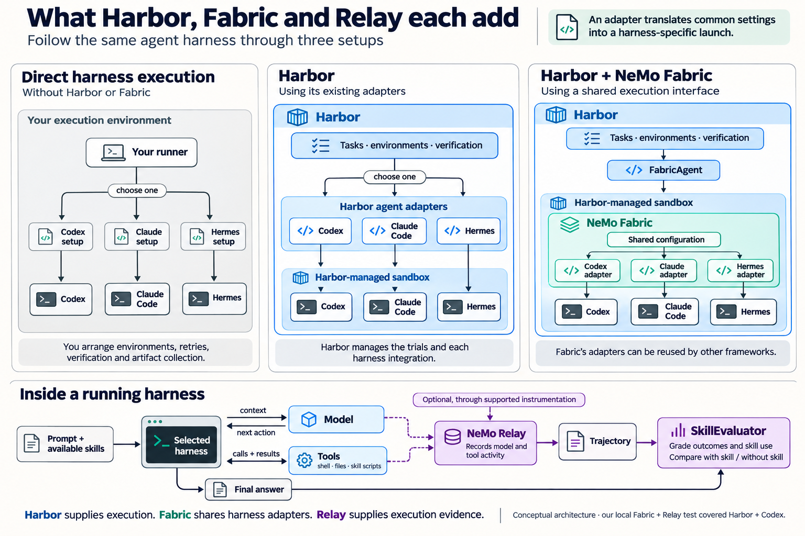
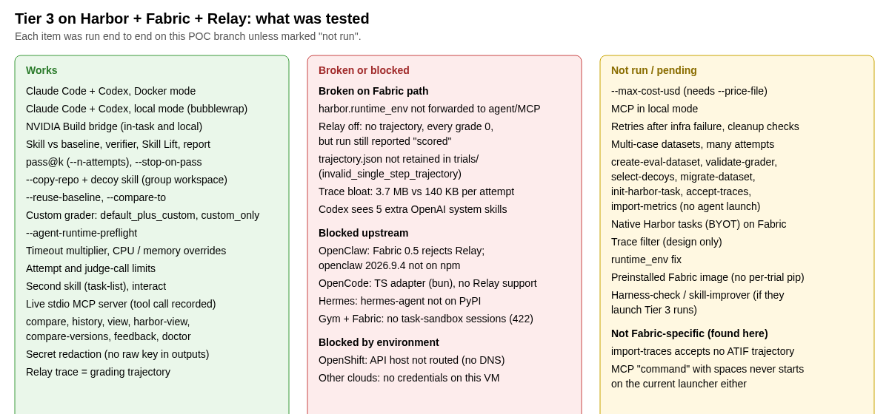
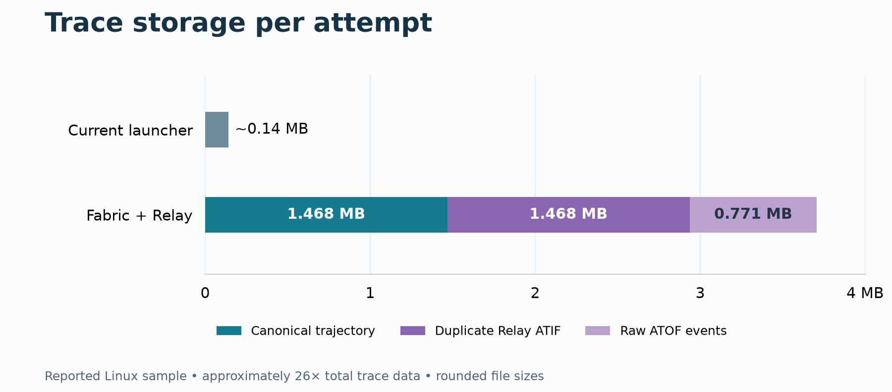
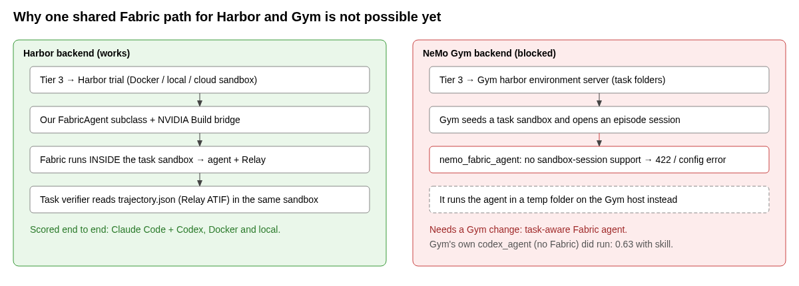

# NeMo Fabric and Relay + SkillEvaluator

## At a glance

| Status | What we have | What we need |
|---|---|---|
| Works | Claude Code and Codex on Harbor, Docker and Linux local; Build bridge, paired grading and reports. | Use current launchers + optional Relay for observability. |
| Broken | Fabric runtime_env forwarding, evidence status and some trace retention; oversized duplicate traces. | Fix transport and evidence handling; validate a compact trace filter. |
| Blocked | Gym + Fabric sessions; OpenClaw, OpenCode and Hermes on the tested Fabric stack. | Compatible adapters/packages and a task-aware Gym agent. |
| Pending | Cloud/Kubernetes, cost budgets, failure recovery and broader qualification. | Reachable infrastructure and the remaining test matrix. |

## Scope

Use Harbor with the current launchers and optional Relay for observability. This path preserves working runtime_env forwarding and trace retention. Its shared remaining issue is oversized, duplicated Relay traces, addressed by the same proposed trace filter. Keep Harbor + Fabric + Relay experimental until its configuration and evidence gaps are fixed. Defer Gym + Fabric until task-sandbox sessions are supported.

The implementation is on [poc/fabric-relay-tier3](https://github.com/NVIDIA/SkillEvaluator/tree/poc/fabric-relay-tier3), starting at [283a3e58](https://github.com/NVIDIA/SkillEvaluator/commit/283a3e581a54057e6afe3f9096441b8dcc8b02ba). This is POC code. Its Fabric launcher is selected by an environment flag. Code review also found an unconditional Hermes authentication change that needs regression coverage before describing the whole patch as opt-in.

Two environments were exercised. The Linux POC run covered Claude Code and Codex in Docker and Linux local mode through NVIDIA Build. The local Docker Codex run used a Responses-compatible gateway. Their providers, runtimes and fixtures differ. The small samples establish integration behavior. Quality and performance gains require larger controlled comparisons.

## How the components work together



Harbor already runs harnesses through its own adapters. It owns tasks, environments, retries and verifier execution. Fabric adds a common configuration and execution interface whose adapters can be reused across applications. Our FabricAgent subclasses preserve the NVIDIA Build bridge that translates Anthropic Messages or OpenAI Responses calls to Build and supplies authentication. Relay records model and tool activity and exports the ordered trajectory used by the graders. SkillEvaluator creates paired trials, supplies graders, aggregates Skill Lift and pass@k, and writes reports. Harness support and optional capabilities depend on the chosen adapter and version.

One Fabric attempt follows this sequence.

1. SkillEvaluator creates a Harbor task for one case and one condition, with or without the target skill. It stages instructions, skills, optional MCP configuration, environment definition and verifier files.
2. Harbor prepares the sandbox. Our subclass starts the Build bridge. Fabric configures the selected harness and starts it with Relay enabled.
3. Model traffic follows harness → Relay → Build bridge → NVIDIA Build. Tool activity returns to the harness and is recorded through supported Relay instrumentation.
4. Harbor's FabricAgent promotes Relay ATIF to the canonical `agent/trajectory.json`. The local-mode subclass performs an additional promotion because host path rewriting conflicts with upstream validation.
5. The verifier consumes the trajectory and runs deterministic checks, the LLM judge and any configured custom grader. Judge requests use the judge provider directly.
6. SkillEvaluator collects rewards and retained artifacts, computes the paired results and emits HTML, JSON and benchmark outputs.

The existing Harbor path obtains a canonical trajectory through its per-agent conversion logic. Relay can also be attached to existing launchers. In the tested Fabric path, Relay was necessary to supply evidence the standard grader could consume. Missing evidence must be treated as an ungraded attempt.

## Implementation and test setup

The six changed source files are under `src/skillevaluator/`.

- `tier3/harbor/fabric_agents.py` adds Claude Code and Codex FabricAgent subclasses, Build bridge setup, local path mapping and local Relay trajectory promotion. `SKILLEVALUATOR_FABRIC_LAUNCHER=1` selects them. `SKILLEVALUATOR_FABRIC_TELEMETRY` selects `relay` or `none`. Local mode also requires `SKILLEVALUATOR_FABRIC_HOST_PYTHON`.
- `tier3/harbor/relay.py` supplies Relay installation, configuration and command wrapping. `SKILLEVALUATOR_NEMO_RELAY_BINARY` selects a host-side Linux Relay binary for the existing launcher hooks.
- `tier3/harbor/local_agents.py` and `tier3/harbor/hermes_agent.py` connect the existing launchers to Relay. Hermes receives its plugin configuration.
- `tier3/harbor/runner.py` selects the experimental Fabric classes and adds the Hermes API-key selection. The latter applies independently of the Fabric flag.
- `tier3/nemo_gym/runner.py` adds `SKILL_EVAL_NEMO_GYM_MODEL_TYPE` and the `SKILL_EVAL_NEMO_GYM_FABRIC=1` probe for `nemo_fabric_agent` with Relay enabled.

The tested stack used Harbor 0.25.0 and Fabric 0.5.0. The Harbor Fabric extra constrains Fabric to the 0.5 series. The local Docker Codex run used Relay 0.10.4. Compatibility statements in this report refer to that tested stack.

The Linux POC run used Docker and bubblewrap, NVIDIA Build models `nvidia/nemotron-3.5-lightning-30b-a3b` and, for MCP runs, `nvidia/nemotron-3-ultra-550b-a55b`. The judge used the latter model. Fixtures included calculator, task-list, a text-analyzer decoy, a custom grader, and a live stdio MCP server. Most tests used one case and one attempt per condition. The Linux POC run passed 531 runner tests. Two intermittent failures in the wider suite passed on rerun.

The local Docker Codex run used SkillEvaluator main `2ca66b7d`, Codex and `azure/openai/gpt-5.4-mini` through an existing Responses-compatible gateway. It ran an arithmetic case and an unrelated control, each with and without the skill. Fabric on/off shared a task tree and image. The existing launcher reference used a different runtime/image. Its targeted environment/backend suite recorded 595 passed, 2 skipped and 1 deselected. All three HTML reports rendered and agreed with their result JSON. That rendering check also reproduced the misleading fallback-zero report.

The documentation pass also reran the pushed POC branch's Harbor environment, artifact and status tests and Gym backend tests, using the existing Harbor 0.25 environment. The result was 652 passed, 3 skipped and 1 deselected. This checks the branch against that test subset. The live integration outcomes above remain from their respective original runs.

## Results and feature coverage



Overview of the exercised Linux POC paths. The detailed matrix identifies partial checks, including budget enforcement, resource enforcement and prior-revision comparison, and the limits of the secret scan.

### Linux POC run scores

The table shows rounded scores. Skill Lift was calculated from underlying values, so subtracting displayed values can differ by 0.01. A dash means that result was not recorded.

| Launcher and mode | With skill | Without skill | Skill Lift |
|---|---:|---:|---:|
| Current Claude Code · Docker | 0.97 | — | — |
| Fabric + Relay Claude Code · Docker | 0.97 | 0.52 | +0.44 |
| Current Codex · Docker | 0.42 | — | — |
| Fabric + Relay Codex · Docker | 0.63 | 0.89 | −0.26 |
| Current Claude Code · local | 0.89 | 0.89 | 0.00 |
| Fabric + Relay Claude Code · local | 0.64 | 0.89 | −0.24 |
| Current Codex · local | 0.35 | 0.89 | −0.54 |
| Fabric + Relay Codex · local | 1.00 | 0.59 | +0.41 |
| Fabric, Relay off · both harnesses, Docker | Invalid zero | Invalid zero | Ungraded |
| Native Gym codex_agent · Docker | 0.63 | — | — |
| Gym + Fabric + Relay · Docker | Blocked | Blocked | — |

### Local Docker Codex run

The current Harbor launcher produced usable grades for 4/4 attempts. Fabric with Relay off completed all four attempts and verifiers, but produced 0/4 usable standard grades. The calculator output was correct, yet the verifier substituted zeros because it found no canonical trajectory or reconstructible log. Fabric with Relay on produced 4/4 usable grades and four canonical trajectories identical to the corresponding Relay ATIF files. Its ATOF files held 326 records in total. The paired report showed +0.0333 Skill Lift on this tiny fixture.

The positive skill trial read SKILL.md, attempted two incorrect script paths, then executed the correct calculator script and answered 14. This trace supports investigation of skill execution and recovery. The prompt explicitly requested the skill when available, so this run does not test spontaneous discovery. A separate outcome-only Harbor verifier passed with Relay both off and on.

### Linux POC feature matrix

“Passed” below means the stated scenario completed. Limits that were configured without being reached remain only partially tested.

| Feature | Result | Evidence or remaining limit |
|---|---|---|
| Docker; Linux local mode | Passed | Claude Code and Codex, paired runs. Local needed POC workarounds. |
| NVIDIA Build bridge | Passed | Used across the Linux POC agent runs. |
| Skill staging, decoys, copy-repo | Passed | Group workspace with text-analyzer decoy, score 0.97. |
| pass@k and stop-on-pass | Passed | Two attempts; a three-attempt budget stopped after one pass. |
| Baseline reuse | Passed | Second run reused a baseline under matching settings. |
| compare-to | Partial | The no-prior-skill-revision path completed. Revision comparison remains pending. |
| Runtime preflight | Passed | Fabric startup completed in approximately 45 seconds. |
| Timeout and resource settings | Partial | 1.5 multiplier, 2 CPUs and 4096 MB appeared in trial config. Enforcement was not stressed. |
| Attempt and judge-call budgets | Partial | Runs stayed within limits. Boundary enforcement remains pending. |
| Dollar-cost budget | Untested | Requires a price file. |
| Custom graders | Passed | Default-plus-custom produced 0.63 and custom_check 1.0; custom-only produced 1.00. |
| Second skill and interaction | Passed | task-list scored 1.00 versus 0.43; combined calculator/task-list scored 1.00, interaction 0. |
| Live stdio MCP | Passed | Relay recorded mcp__magic__get_magic_number. Local MCP remains untested. |
| harbor.runtime_env | Broken | Configured value did not reach the agent/MCP server. Current launcher passed it. |
| Read-only run commands | Passed | compare, history, view, compare-versions, feedback, doctor; harbor-view returned HTTP 200. |
| ATIF import through import-traces | Gap | Zero candidates for Relay ATIF/ATOF and existing Harbor trajectory.json. |
| Secret scan | Limited pass | Linux POC outputs contained no raw key. Local Docker Codex outputs had no exact current gateway-key match. |
| OpenClaw, OpenCode, Hermes via Fabric | Blocked in tested setup | Adapter, telemetry and package-installation failures detailed below. |
| Cloud and Kubernetes | Untested | API reachability and cloud credentials were unavailable in the Linux test environment. |
| Gym with Fabric | Blocked | Episode-session and sandbox contract fails before execution. |

## Trace size, copying and retention



The Linux POC sample retained approximately 3.7 MB of trace data per attempt versus approximately 140 KB with the current launcher, around 26 times as much. These are sample measurements, not a universal multiplier. The whole run folders were 5.4 MB and 1.9 MB respectively.

| Artifact per attempt | Current launcher | Fabric + Relay | Grading role |
|---|---:|---:|---|
| Canonical trajectory.json | 10 KB | 1,468 KB | Read by the verifier |
| Original Relay ATIF | — | 1,468 KB | Byte-identical second copy |
| Relay ATOF event log | — | 771 KB | Diagnostic raw events |
| Native session log | 120 KB | Not retained in this sample | Current converter input |
| Approximate trace total | 140 KB | 3,707 KB | Includes rounded totals |

Within the 1.47 MB Relay trajectory, the Linux POC run measured roughly 8 KB of grading-relevant steps, 807 KB under `extra.observed_events`, and 381 KB of per-step `extra.llm_request`. Repeated requests include the system prompt, tools and skill text. ATIF also carries tool observations, metrics, invocation and ancestry fields. ATOF is a JSONL stream of scope/mark events with identifiers, timestamps, parents and event data.

Harbor copies the original Relay ATIF to its canonical trajectory, duplicating the file. The canonical file itself embeds raw events and request payloads that overlap other records. The Tier 3 collector rejected a Claude trajectory containing six steps with `invalid_single_step_trajectory`, leaving it only in retained raw Harbor jobs. The error label does not establish why this six-step trace was rejected. Root cause not investigated. The local Docker Codex run retained all four trajectories.

`enable_full_payloads=false` was already set. The tested Harbor integration exposed Relay on/off, and the team found no effective exposed setting to omit both embedded event and request collections. Relay has its own ATOF configuration. We need to expose and validate the relevant controls before making a broader statement about all Relay or Fabric versions.

A proposed retention policy is to keep one canonical, grader-compatible trajectory, preserve the provenance and fields needed for scoring, and retain compressed raw diagnostics only when requested. A derived “skill text reached the model” indicator can support debugging, but does not establish skill use. Before dropping fields, replay all default/custom graders and activation checks against original and filtered traces and compare their outputs. Store a format/version marker and avoid collecting unrelated harness state. The local Docker Codex review found Codex runtime state inside the raw Fabric artifact tree as well.

The typical retained paths explain where the copies arise.

```text
run/
  report.html, result.json, tier3-benchmark.md, run_config.json
  <agent>/<condition>/trials/<trial>/
    rewards, configs, logs, retained trajectory when accepted
  _harbor-tasks/<task>/
    instructions, environment, skills and verifier
  _harbor-jobs/<trial>/agent/
    trajectory.json                    canonical grading input
    fabric-artifacts/.../relay/<run>/
      trajectory-<id>.atif.json        duplicate canonical content
      events.atof.jsonl                raw event stream
    fabric-artifacts/.../.fabric/      runtime state and diagnostics
    fabric-run-*.json, fabric-result-*.json
    nvidia-build-bridge.log
```

## Issues and requested fixes

### Asks by team

| Team | Requested changes |
|---|---|
| Fabric | Native canonical trajectory; observability controls through FabricAgent; isolated Codex skills; flexible artifact roots and deferred model endpoint; compatible OpenClaw, OpenCode and Hermes adapters/packages. |
| Relay | Minimal ATIF with optional embedded events and request payloads; configurable raw-event export; supported telemetry for the blocked adapters. |
| Gym | Task-aware nemo_fabric_agent using the task sandbox, episode sessions and verifier-compatible evidence. |
| Infra | Reachable Kubernetes/OpenShift API or credentials for a selected cloud environment. |
| SkillEvaluator | Forward runtime_env; mark missing evidence unscored; investigate six-step trace rejection; deduplicate/filter and retain traces; prebuild dependencies; validate MCP commands; gate/test Hermes auth and handle silent local promotion. |

### Evidence and correctness

- **1 · Canonical evidence requires Relay on the tested Fabric path.** Telemetry-off runs yield fallback zero scores. Fabric/Harbor should provide a native canonical trajectory or document and enforce the dependency.
- **2 · Missing evidence is counted as scored.** SkillEvaluator should mark attempts unscored with an explicit evidence error, exclude them from valid-score denominators, and make the report incomplete when expected evidence is absent.
- **3 · Runtime environment values are lost.** The Fabric subclass needs to forward `harbor.runtime_env` through the supported environment transport and test both agent and MCP visibility, including secret handling.
- **4 · A six-step Claude trajectory was discarded during collection.** The collector returned `invalid_single_step_trajectory` despite the trace containing six steps. Root cause not investigated. SkillEvaluator needs to reproduce the rejection, identify the actual failing condition and retain valid Relay trajectories.
- **5 · Duplicate and oversized traces.** SkillEvaluator should deduplicate retained ATIF and implement a validated compact form. Relay should expose a minimal trajectory mode, and the Harbor/Fabric integration should pass through observability settings.

### Startup, isolation and compatibility

- **6 · Per-trial installation adds cost and network failure points.** The Linux POC run measured approximately 717 MB installed, about 15 seconds setup versus 11 seconds, and one DNS failure. SkillEvaluator should qualify prebuilt, pinned images with Fabric and the required adapters.
- **7 · Codex receives additional system skills.** The Linux POC run observed five extra skills, changing the evaluation context. Fabric should support explicit skill isolation, with an inventory proving equivalent with-skill and baseline conditions.
- **8 · Local mode relies on path workarounds.** Fabric validates literal `/logs/agent`, while local mode rewrites paths. Its runtime also needs to live outside the home directory hidden by bubblewrap. Fabric should accept the supplied artifact root; SkillEvaluator should verify promotion, cleanup and failure reporting.
- **9 · Claude startup needs sandbox and endpoint workarounds.** The subclass sets `IS_SANDBOX=1` and supplies a construction-time placeholder URL until the Build bridge starts. Fabric should support deferred endpoint configuration and a clear sandbox contract.
- **10 · OpenClaw failed in the tested stack.** The Linux POC run encountered rejected Relay telemetry and an unavailable required npm version. Fabric/OpenClaw owners need compatible released packages and supported telemetry. Current package availability must be rechecked before retrying.
- **11 · OpenCode failed in the selected catalog.** The Linux POC run found a TypeScript adapter requiring bun and its SDK, outside the selected Python path, with Relay unsupported. Fabric/Relay need a compatible launch and evidence path.
- **12 · Hermes installation failed.** The Linux POC run could not resolve the requested hermes-agent 0.20+ package through its install path. Hermes/Fabric owners should provide a reproducible compatible installation. This is distinct from earlier Relay hooks on the existing Hermes launcher.

### Backend and adjacent gaps

- **13 · Gym Fabric lacks task-sandbox sessions.** Gym needs a task-aware Fabric agent that uses the existing sandbox and supports episode-session lifecycle. It must preserve verifier access and return evidence before temporary directories are removed.
- **14 · Cloud/Kubernetes qualification is pending.** Infrastructure owners need to provide API reachability or usable credentials for a selected environment. The POC provides no cloud execution result.
- **15 · Token and cost data were absent on the reported Build route.** The Build integration needs to return and normalize usage, then test priced budgets. This finding is limited to the observed route.
- **16 · An MCP command example is invalid.** SkillEvaluator should validate an executable separately from arguments and correct examples using a space-containing command string. This also affects existing launchers.
- **17 · ATIF import is unsupported by the exercised import-traces path.** SkillEvaluator needs either an explicit ATIF importer or clear supported-format behavior. The same gap occurred with existing Harbor trajectories.

Code review adds two behavior checks. The Hermes API-key override applies to every Hermes run, including when Fabric is off, and should be gated or covered by its own regression test. Local ATIF promotion silently returns for zero or multiple Relay candidates and for an existing trajectory.json, so missing or stale evidence needs explicit handling. The eager Fabric import is low risk because Harbor handles a missing nemo_fabric package and raises only when Fabric is selected. A clean-install test without Fabric remains pending. Local path escaping and retries also need coverage.

## Gym status and remaining qualification



Harbor completed Docker and Linux local runs. Cloud sandboxes are an architectural option shown here and remain untested. Gym + Fabric stopped at the task-sandbox session contract.

The local Gym probe first rejected the stock Fabric preset because task-folder mode requires exactly one responses_api_agents instance. A flattened configuration passed that admission step, but the live native endpoint returned HTTP 422, “This agent does not implement episode sessions.” No Fabric-driven model execution, score or Relay trajectory was produced on that path.

The Linux POC run recorded a native Gym codex_agent score of 0.63 after updating uv to at least 0.13.4, selecting a host address reachable from the sandbox, and using the vllm_model path for the Build endpoint. Tier 3's current Gym backend supports Docker. A Fabric agent running in a temporary host directory cannot satisfy the existing sandbox/verifier contract by changing `relay=true` alone.

The remaining work is concrete.

- Implement the six SkillEvaluator fixes for environment forwarding, unscored evidence failures, trajectory retention, validated trace reduction, prebuilt dependencies, and MCP command validation.
- Resolve the Fabric/Relay configuration, skill-isolation, local-path and harness-compatibility requests above. Qualify Gym after its session adapter exists.
- Run cloud/Kubernetes with reachable services, cost budgets with a price file, local MCP, and budget boundary enforcement. Exercise a real prior-revision comparison.
- Test infrastructure failure retries, cleanup, concurrent trials, larger datasets, repeated attempts and native Harbor tasks. Verify harness-check and skill-improver if their selected paths launch Tier 3.
- The POC did not exercise create-eval-dataset, validate-grader, select-decoys, migrate-dataset, init-harbor-task, accept-traces or import-metrics. They do not establish Fabric launch compatibility.
- Repeat redaction and artifact-retention checks across the qualified matrix. Exact-key scans alone do not establish general secret protection.

For adoption, use the current Harbor launchers with optional Relay when observability is the goal, and validate the shared trace filter. Qualify the experimental Fabric route after its configuration, evidence and retention fixes. Fabric offers a reusable harness integration boundary. The shared Harbor/Gym path and broad harness parity remain to be demonstrated.

## Reproduction and references

These commands describe the Linux POC setup. Use a Linux host with Docker, configured Build credentials and the selected judge model. Local mode additionally needs bubblewrap and a Fabric Python environment visible inside the confinement. Model access and package availability should be checked before execution.

```bash
git fetch origin poc/fabric-relay-tier3
git switch poc/fabric-relay-tier3
uv sync --extra tier3 --extra dev
# Set NVIDIA_API_KEY in the environment using your normal secret workflow.
export SKILL_EVAL_JUDGE_MODEL=nvidia/nemotron-3-ultra-550b-a55b

SKILLEVALUATOR_FABRIC_LAUNCHER=1 uv run skillevaluator tier3 \
  src/skillevaluator/tier3/reference_skills/calculator \
  --backend harbor -a claude-code \
  --model nvidia/nemotron-3.5-lightning-30b-a3b \
  --max-cases 1 --n-attempts 1 --harbor-keep-jobs \
  --results-dir ./poc-results/fabric-claude

# Repeat with -a codex. Run the reference with the Fabric flag unset.
# Probe the known missing-evidence path with both settings:
export SKILLEVALUATOR_FABRIC_LAUNCHER=1
export SKILLEVALUATOR_FABRIC_TELEMETRY=none
# Then repeat the Tier 3 invocation above into a fresh results directory.
```

For Linux local mode, provision a writable `/opt/sefabric` location first. The explicit Python path below ensures the dependencies enter the environment used by Fabric.

```bash
UV_PYTHON_INSTALL_DIR=/opt/sefabric/python \
  uv venv --python 3.12 --managed-python /opt/sefabric/venv
uv pip install --python /opt/sefabric/venv/bin/python \
  'nemo-fabric[claude,codex,relay]==0.5.0'
export SKILLEVALUATOR_FABRIC_HOST_PYTHON=/opt/sefabric/venv/bin/python
export SKILLEVALUATOR_FABRIC_TELEMETRY=relay
# Repeat the Tier 3 invocation with --env-mode local and a fresh results directory.
```

For the native Gym probe, `SKILL_EVAL_NEMO_GYM_MODEL_TYPE=vllm_model` selects the reported Build-compatible model path. `SKILL_EVAL_NEMO_GYM_FABRIC=1` selects the experimental Fabric agent and currently reaches the session blocker. These switches do not complete the missing Gym integration.

General contracts are documented in [Harbor's agent integrations](https://docs.harborframework.com/agents/pre-integrated-agents), [Fabric's Harbor integration](https://docs.nvidia.com/nemo/fabric/v0.5.0/integrations/consumer-integrations/harbor) and [Relay's runtime overview](https://docs.nvidia.com/nemo/relay/v0.10.4/about-nemo-relay/overview). The architecture figure is explanatory. The storage chart shows the Linux POC sample.
