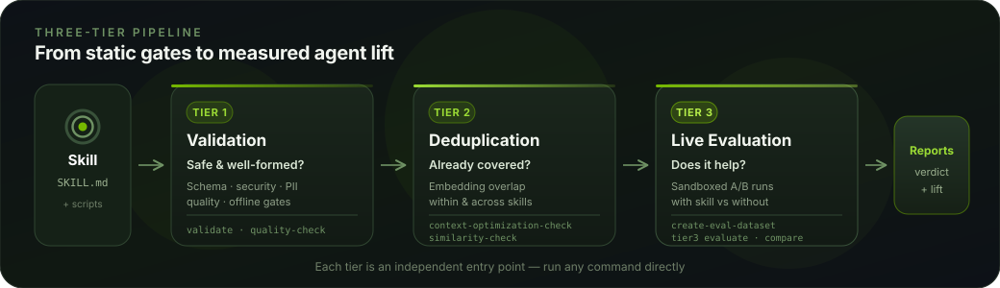

# SkillEvaluator


[](LICENSE)
[](https://www.python.org/)
[](https://pypi.org/project/skillevaluator/)
[](https://docs.nvidia.com/skills/skillevaluator/)
[](https://arxiv.org/abs/2608.20614)
[](https://developer.nvidia.com/blog/evaluating-ai-agent-skill-performance-with-nvidia-skillevaluator/)

> 📺 **Livestream:** [Ask the Experts: Evaluating Agent Skills](https://www.youtube.com/watch?v=4rI0zATFxYI)

SkillEvaluator checks AI agent skills, then compares task results with and without them.

Agent skills are folders of instructions and supporting files defined by the
[Agent Skills specification](https://agentskills.io/). SkillEvaluator is part of
the [NVIDIA Verified Skills pipeline](https://github.com/NVIDIA/skills).

## Get started

Three ways, one CLI, same results.

<table>
<tr>
<th width="33%">1. Run the CLI</th>
<th width="33%">2. Add it to your repo via CI</th>
<th width="33%">3. Wire it to your agent</th>
</tr>
<tr valign="top">
<td>

Install (or `uv tool install`):

```bash
pip install skillevaluator
```

Run all Tier 1 checks, no API key:

```bash
skillevaluator validate \
  ./my-skill --tiers 1
```

Or run from a clone: [Quickstart](#quickstart).

</td>
<td>

Check changed skills on every pull request. On GitHub, run:

```bash
skillevaluator ci init
```

It opens a setup PR. On GitLab, copy the [CI template](https://github.com/NVIDIA/SkillEvaluator/tree/main/ci/bundles/0.9.0).

</td>
<td>

Add the [SkillEvaluator skill](skills/skillevaluator/) to Claude Code, Codex or any skill-aware agent:

```bash
npx skills add \
  NVIDIA/SkillEvaluator
```

Then ask: *"Is my skill any good?"* No Node.js? [Copy the folder](docs/agent-skill.mdx#install).

</td>
</tr>
</table>

Guides: [installation](https://docs.nvidia.com/skills/skillevaluator/installation),
[CI setup](docs/cli-onboarding.mdx) ([GitHub](docs/github-actions.mdx),
[GitLab](docs/gitlab-ci.mdx), [report examples](ci/examples/README.md)) and
[agent skill](docs/agent-skill.mdx).

## Quickstart

Both use bundled `text-analyzer`.

| Start here | Requires | First result |
| --- | --- | --- |
| [Run without an LLM](#run-without-an-llm) | Git and uv | A deterministic quality score and findings |
| [Use NVIDIA Build](#use-nvidia-build) | Git, uv, and a Build API key | Model-backed rubric scores and feedback |

Install [uv](https://docs.astral.sh/uv/getting-started/installation/) and Git,
then get the example:

```bash
git clone --depth 1 https://github.com/NVIDIA/SkillEvaluator.git
cd SkillEvaluator
```

uv provisions Python 3.13 and dependencies. For standalone installation, see
[Installation](https://docs.nvidia.com/skills/skillevaluator/installation).

### Run without an LLM

```bash
uv run --python 3.13 skillevaluator quality-check \
  src/skillevaluator/tier3/reference_skills/text-analyzer \
  -r cli -r json -o reports/first-quality
```

No API key, scanner, GPU or Docker is needed. The example scores **84.5/100 (B)**,
exits `0` and saves `reports/first-quality/skillevaluator-quality.json`. The
passing threshold defaults to 70.

This checks static quality; publication evidence stays `INCOMPLETE`. Security
needs scanners; agent impact needs live evaluation. Replace the example path
with your skill directory. See the
[keyless walkthrough](docs/quickstart.mdx#run-without-an-llm).

### Use NVIDIA Build

Eligible NVIDIA Developer Program members can use NVIDIA-hosted endpoints for
**free prototyping**, subject to [access terms and rate limits](https://docs.api.nvidia.com/nim/docs/product).

1. Sign in at [build.nvidia.com](https://build.nvidia.com/) and complete enrollment.
2. Open a model page, select **Get API Key**, and generate your key.
3. Set the provider and key in the same terminal, then run the rubric check:

```bash
export SKILL_EVAL_LLM_PROVIDER=nv_build
export NVIDIA_API_KEY='nvapi-...'
uv run --python 3.13 --extra llm skillevaluator rubric-eval \
  src/skillevaluator/tier3/reference_skills/text-analyzer \
  -r cli -r json -o reports/first-build
```

It sends skill documentation to the model and saves feedback in
`reports/first-build/skillevaluator-rubric.json`. No agent runtime or Docker is
needed. Completed evaluations can still fail rubric thresholds.

The same key supports Tier 2 and Tier 3. See [provider configuration](docs/configuration.mdx).

## Three-tier overview



Each tier is independent. Add its extra to your command:

| Tier | Question | Example after setup | Additional setup |
| --- | --- | --- | --- |
| Tier 1: Validation | Is the skill safe and well-formed? | `uv run skillevaluator tier1 ./my-skill --no-llm` | External scanners for full static coverage; a provider and model clients enable LLM checks |
| Tier 2: Deduplication | Does guidance repeat or overlap? | `uv run --extra tier2 skillevaluator tier2 ./my-skill` | Embeddings and chat; add `--catalog ./skill-catalog.json` for inter-skill comparison |
| Tier 3: Live Evaluation | Does the skill help the agent? | `uv run --extra tier3 skillevaluator tier3 ./my-skill` | Provider access, a supported agent, and a running sandbox (Docker by default) |

Tier 1 fetches pinned, verified SkillSpector and Gitleaks releases when they
are missing; Semgrep is optional. See [scanners](docs/installation.mdx#system-tools).
`--no-llm` does not remove scanner requirements; a scanner that cannot run is
`INCOMPLETE` and exits nonzero.
[SkillSpector](https://github.com/NVIDIA/SkillSpector) provides specialized skill
security scanning; [Harbor](https://github.com/harbor-framework/harbor), the
open-source agent evaluation framework, powers sandboxed agent runs.

Tier 2 reports when inter-skill comparison did not run. Tier 3 autopilot reuses
sources or creates one skill-grounded case with limited coverage. See
[tier guides](https://docs.nvidia.com/skills/skillevaluator/).

## Run the combined pipeline

After setting up the provider, scanners, and agent sandbox, run all three tiers:

```bash
uv run --python 3.13 --extra all skillevaluator doctor --env-mode docker
uv run --python 3.13 --extra all skillevaluator validate ./my-skill
```

`doctor` checks readiness, not inference success. `validate` runs all tiers with
autopilot for skills. Use `--tiers 1,2` to skip live evaluation or `--tiers 1` for
static checks. `--no-autopilot` requires an existing source. Other artifact types
retain their applicable stages.

Tier 1 gates `validate`. Tier 2 gates unless `--no-block-on-dedup` is set;
Tier 3 gates only with `--block-on-agent-eval`. Model and managed-sandbox usage
can incur charges; see [runtime and cost](docs/tier3-live-evaluation.mdx#plan-for-cost).

Standalone generation needs substantive `evals/EVAL.md` guidance, a `--prompt`
file with task requests and outcomes, or matching retained traces. `--force`
below replaces the autopilot starter; `--refine` refines it. Explicit
`--grounding skill` permits skill-only starters. Review cases; templates omit
unauthored negatives.

```bash
uv run --python 3.13 --extra tier3 skillevaluator tier3 create-eval-dataset ./my-skill --full --prompt eval-guidance.md --force
```

## Run from a source checkout

See [Installation](docs/installation.mdx#choosing-extras) for extras and standalone upgrades.

## Research and citation

Resources: [paper](https://arxiv.org/abs/2608.20614),
[PDF](https://arxiv.org/pdf/2608.20614),
[DOI](https://doi.org/10.48550/arXiv.2608.20614),
[BibTeX](https://arxiv.org/bibtex/2608.20614), and the
[NVIDIA Developer blog](https://developer.nvidia.com/blog/evaluating-ai-agent-skill-performance-with-nvidia-skillevaluator/).
Cite the paper and record the SkillEvaluator release or commit; see [CITATION.cff](CITATION.cff).

## Documentation

See [documentation](https://docs.nvidia.com/skills/skillevaluator/) for
setup, tier guides, reports, CI integration, CLI reference, and
[performance dashboard](docs/reports.mdx#performance-dashboard).

## Installation and third-party software

Follow the [installation guide](https://docs.nvidia.com/skills/skillevaluator/installation)
to choose the full installation or a smaller per-tier setup.

This project will download and install additional third-party open source
software projects. Review the license terms of these open source projects before
use.

## Contributing

Read [CONTRIBUTING.md](CONTRIBUTING.md) and run:

```bash
make lint && make test && make build
```

See [project governance](GOVERNANCE.md) and the [Code of Conduct](CODE_OF_CONDUCT.md).

## Support

Support level: **Experimental**. Community-supported, best-effort, with no SLA
or NVIDIA enterprise support entitlement. Report bugs and feature requests through
[GitHub Issues](https://github.com/NVIDIA/SkillEvaluator/issues); see
[SUPPORT.md](SUPPORT.md).

## Security

Report suspected vulnerabilities using the private process in
[SECURITY.md](SECURITY.md). Do not disclose security issues in a public GitHub
issue.

## Releases

Release notes: [CHANGELOG.md](CHANGELOG.md) and
[GitHub Releases](https://github.com/NVIDIA/SkillEvaluator/releases).

## Assess plugins

Run static checks: `skillevaluator validate ./my-plugin --tiers 1`. Compare runs:
`skillevaluator tier3 evaluate-plugin ./my-plugin --agents claude-code`. Replay evidence:
`tier3 report-plugin RUN_DIR`. See [formats and evidence limits](docs/plugin-assessment.mdx).

## License

Apache License 2.0 — see [LICENSE](LICENSE), [NOTICE](NOTICE), and
[THIRD_PARTY_NOTICES.md](THIRD_PARTY_NOTICES.md).

Copyright (c) 2026 NVIDIA CORPORATION & AFFILIATES. All rights reserved.
