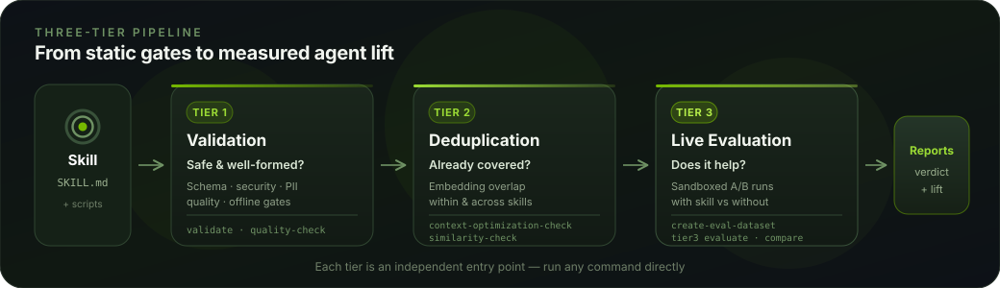

# SkillEvaluator


[](LICENSE)
[](https://www.python.org/)
[](https://docs.nvidia.com/skills/skillevaluator/)
[](https://arxiv.org/abs/2608.20614)
[](https://developer.nvidia.com/blog/evaluating-ai-agent-skill-performance-with-nvidia-skillevaluator/)

> 📺 **Livestream:** [Ask the Experts: Evaluating Agent Skills](https://www.youtube.com/watch?v=4rI0zATFxYI)

SkillEvaluator is an open-source tool that checks AI agent skills and measures their effect on an agent's
task results. Start with a quality check or model-backed feedback, then compare
live runs with and without a skill.

Agent skills are folders of instructions and supporting files defined by the
[Agent Skills specification](https://agentskills.io/). SkillEvaluator is part of
the [NVIDIA Verified Skills pipeline](https://github.com/NVIDIA/skills).

## Quickstart

Choose a starting path. Both use the bundled `text-analyzer` skill; try your own afterward.

| Start here | Requires | First result |
| --- | --- | --- |
| [Run without an LLM](#run-without-an-llm) | Git and uv | A deterministic quality score and findings |
| [Use NVIDIA Build](#use-nvidia-build) | Git, uv, and a Build API key | Model-backed rubric scores and feedback |

Install [uv](https://docs.astral.sh/uv/getting-started/installation/) and Git,
then get the example:

```bash
git clone --depth 1 https://github.com/NVIDIA/SkillEvaluator.git
cd SkillEvaluator
```

uv provisions Python 3.13 and installs each path's dependencies. Run from this
checkout. For a standalone CLI, see
[Installation](https://docs.nvidia.com/skills/skillevaluator/installation).

### Run without an LLM

```bash
uv run --python 3.13 skillevaluator quality-check \
  src/skillevaluator/tier3/reference_skills/text-analyzer \
  -r cli -r json -o reports/first-quality
```

No API key, external scanner, GPU, or Docker is needed. The example scores
**84.5/100 (B)** and exits `0`, with seven non-blocking findings. The default
passing threshold is 70. Read the terminal or saved
`reports/first-quality/skillevaluator-quality.json` report.

This checks static quality; publication evidence stays `INCOMPLETE`. Security
coverage needs scanners, and agent impact needs live evaluation. To check your
own skill, replace the example path with your `SKILL.md` directory. See the
[keyless walkthrough](docs/quickstart.mdx#run-without-an-llm).

### Use NVIDIA Build

NVIDIA Developer Program members can use eligible NVIDIA-hosted endpoints for
**free prototyping**, subject to current access terms and rate limits. See the
[official access FAQ](https://docs.api.nvidia.com/nim/docs/product) and your
NVIDIA Build account for details.

1. Sign in or create an account at [build.nvidia.com](https://build.nvidia.com/)
   and complete any enrollment prompts.
2. Open a model page, select **Get API Key**, and generate your key.
3. Set the provider and key in the same terminal, then run the rubric check:

```bash
export SKILL_EVAL_LLM_PROVIDER=nv_build
export NVIDIA_API_KEY='nvapi-...'
uv run --python 3.13 --extra llm skillevaluator rubric-eval \
  src/skillevaluator/tier3/reference_skills/text-analyzer \
  -r cli -r json -o reports/first-build
```

The `llm` extra adds model clients. The command sends skill documentation to the
model and writes feedback to the terminal and
`reports/first-build/skillevaluator-rubric.json`. No agent runtime or Docker is
needed. Completed evaluations can still fail rubric thresholds; inspect the findings.

Build supplies model defaults; the same key supports Tier 2 embeddings and
supported Tier 3 agents. See the [Build walkthrough](docs/quickstart.mdx#use-nvidia-build)
or [Providers & Credentials](docs/configuration.mdx) for overrides and other providers.

## Three-tier overview



Each tier is independent. Add the relevant extra to your checkout command:

| Tier | Question | Example after setup | Additional setup |
| --- | --- | --- | --- |
| Tier 1: Validation | Is the skill safe and well-formed? | `uv run --extra security skillevaluator tier1 ./my-skill --no-llm` | External scanners for full static coverage; a provider and model clients enable LLM checks |
| Tier 2: Deduplication | Does guidance repeat or overlap? | `uv run --extra tier2 skillevaluator tier2 ./my-skill` | Embeddings and chat; add `--catalog ./skill-catalog.json` for inter-skill comparison |
| Tier 3: Live Evaluation | Does the skill help the agent? | `uv run --extra tier3 skillevaluator tier3 ./my-skill` | Provider access, a supported agent, and a running sandbox (Docker by default) |

Full static Tier 1 needs Semgrep, SkillSpector, and Gitleaks in addition to the
`security` extra. Follow [scanner installation](docs/installation.mdx#system-tools).
`--no-llm` disables model-backed stages; it does not remove scanner requirements.
Missing required scanner evidence is reported as `INCOMPLETE` and exits nonzero.
[SkillSpector](https://github.com/NVIDIA/SkillSpector) provides specialized skill
security scanning; [Harbor](https://github.com/harbor-framework/harbor), the
open-source agent evaluation framework, powers sandboxed agent runs.

Tier 2 reports when inter-skill comparison did not run. Tier 3 reuses valid
evaluation sources or creates one starter case, then runs with and without the
skill. Starter cases provide limited coverage. See the
[tier guides](https://docs.nvidia.com/skills/skillevaluator/) for details.

## Run the combined pipeline

After setting up the provider, scanners, and agent sandbox, run all three tiers:

```bash
uv run --python 3.13 --extra all skillevaluator doctor --env-mode docker
uv run --python 3.13 --extra all skillevaluator validate ./my-skill
```

`doctor` checks readiness, not inference success. `validate` runs all tiers
with autopilot by default for skills; `--full` remains supported but is unnecessary.
Use `--tiers 1,2` or `--no-tier3` to skip live evaluation, or `--tiers 1` for static
checks. `--no-autopilot` requires an existing source. Other artifact types retain
their applicable stages without automatically enabling skill evaluation.

Tier 1 always gates `validate`. Tier 2 gates by default;
`--no-block-on-dedup` makes its findings advisory. Tier 3 is advisory by default;
`--block-on-agent-eval` makes its findings gate too. Model and managed-sandbox
usage depends on the selected provider's terms and can incur charges. Start with
one agent and a small dataset; see [runtime and cost](docs/tier3-live-evaluation.mdx#plan-for-cost).

For broader coverage, generate and review additional cases. Templates omit
negatives unless authored in `EVAL.md`:

```bash
uv run --python 3.13 --extra tier3 skillevaluator tier3 create-eval-dataset ./my-skill --full
```

## Run from a source checkout

Use `uv run --python 3.13` with the relevant extra. See
[Installation](docs/installation.mdx#choosing-extras) for extras and standalone upgrades.

## Research and citation

Resources: [paper](https://arxiv.org/abs/2608.20614),
[PDF](https://arxiv.org/pdf/2608.20614),
[DOI](https://doi.org/10.48550/arXiv.2608.20614),
[BibTeX](https://arxiv.org/bibtex/2608.20614), and the
[NVIDIA Developer blog](https://developer.nvidia.com/blog/evaluating-ai-agent-skill-performance-with-nvidia-skillevaluator/).
Cite the paper for methodology and results. For reproducibility, record the
SkillEvaluator release or commit. See [CITATION.cff](CITATION.cff).

## Documentation

See [the documentation](https://docs.nvidia.com/skills/skillevaluator/) for
setup, tier guides, reports, CI integration, CLI reference, and
[performance dashboard](docs/reports.mdx#performance-dashboard).
For reusable CI, see [GitHub Actions](docs/github-actions.mdx).

## Installation and third-party software

Follow the [installation guide](https://docs.nvidia.com/skills/skillevaluator/installation)
to choose the full installation or a smaller per-tier setup.

This project will download and install additional third-party open source
software projects. Review the license terms of these open source projects before
use.

## Contributing

Read [CONTRIBUTING.md](CONTRIBUTING.md) and run:

```bash
make lint && make test && make build
```

Project governance is described in [GOVERNANCE.md](GOVERNANCE.md). Participation
is governed by the [Code of Conduct](CODE_OF_CONDUCT.md).

## Support

Support level: **Experimental**. SkillEvaluator is community-supported on a
best-effort basis with no SLA or NVIDIA enterprise support entitlement. Report
reproducible bugs and feature requests through
[GitHub Issues](https://github.com/NVIDIA/SkillEvaluator/issues); see
[SUPPORT.md](SUPPORT.md) for details.

## Security

Report suspected vulnerabilities using the private process in
[SECURITY.md](SECURITY.md). Do not disclose security issues in a public GitHub
issue.

## Releases

Release changes are recorded in [CHANGELOG.md](CHANGELOG.md) and
[GitHub Releases](https://github.com/NVIDIA/SkillEvaluator/releases).

## License

Apache License 2.0 — see [LICENSE](LICENSE), [NOTICE](NOTICE), and
[THIRD_PARTY_NOTICES.md](THIRD_PARTY_NOTICES.md).

Copyright (c) 2026 NVIDIA CORPORATION & AFFILIATES. All rights reserved.
