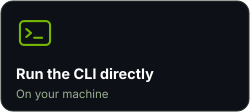
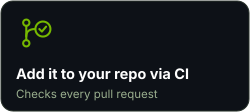
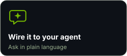
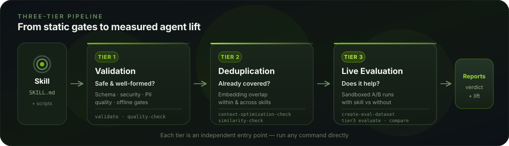

<div align="center">

# 

<h4>Evaluate and improve AI agent skills and plugins: quality, security, overlap, compatibility, and real impact across agents</h4>

[](LICENSE)
[](https://www.python.org/)
[](https://pypi.org/project/skillevaluator/)
[](https://docs.nvidia.com/skills/skillevaluator/repository-integration#copy-a-template)
[](https://docs.nvidia.com/skills/skillevaluator/)
[](https://arxiv.org/abs/2608.20614)
[](https://developer.nvidia.com/blog/evaluating-ai-agent-skill-performance-with-nvidia-skillevaluator/)
[](https://github.com/NVIDIA/SkillEvaluator/stargazers)
[](https://github.com/NVIDIA/SkillEvaluator/forks)

</div>

> 📺 **Livestream:** [Ask the Experts: Evaluating Agent Skills](https://www.youtube.com/watch?v=4rI0zATFxYI)

SkillEvaluator checks AI agent skills and plugins, and measures a skill's effect
on task results: start with quality checks, then compare runs with and without a skill.

Catch skill issues before merge. Connect your repository to SkillEvaluator with a
[CI template](https://docs.nvidia.com/skills/skillevaluator/repository-integration)
for automated quality and security gates, without building or maintaining
evaluation code.

Agent skills are folders of instructions and supporting files defined by the
[Agent Skills specification](https://agentskills.io/). SkillEvaluator is part of
the [NVIDIA Verified Skills pipeline](https://github.com/NVIDIA/skills).

## Get started

Install the CLI in a Python 3.12–3.14 environment:

```bash
pip install skillevaluator
```

<details><summary>Or use uv</summary>

```bash
uv tool install --python 3.13 skillevaluator
```

</details>

For uv setup or direct GitHub source installation, see
[Installation](https://docs.nvidia.com/skills/skillevaluator/installation).

Then check skills from your terminal, CI, or agent:

<table><tbody><tr valign="top">
<td width="33%">

<p></p>

Run checks backed by **500+ static rules and detection patterns**, without an
LLM key. Complete [scanner setup](https://docs.nvidia.com/skills/skillevaluator/installation-options#system-tools)
for full coverage:

```bash
skillevaluator validate \
  ./my-skill --tiers 1
```

<details><summary>Run all three tiers</summary>

After [all-tier setup with NVIDIA Build](#run-all-three-tiers-with-a-free-nvidia-build-key),
remove `--tiers 1` to add deduplication and live agent evaluation to measure
skill lift:

```bash
skillevaluator validate \
  ./my-skill
```

</details>

</td>
<td width="33%">

<p></p>

Check every skill change. Run in your GitHub repo to open a setup PR:

```bash
skillevaluator ci init
```

**Start here:** [Guided setup for GitHub and GitLab](#bring-skill-evaluation-to-your-repository).

</td>
<td width="33%">

<p></p>

Add the skill to Claude Code, Codex or another agent:

```bash
npx skills add \
  NVIDIA/SkillEvaluator
```

Then ask: *"Is my skill any good?"*
See the [agent guide](https://docs.nvidia.com/skills/skillevaluator/agent-skill).

</td>
</tr></tbody></table>

### ⚡ [Harness check](https://docs.nvidia.com/skills/skillevaluator/harness-check): will your agent load your skill?

🔑 **No API key** · 🤖 **No agent run**

```bash
skillevaluator harness-check ./my-skill
```

Illustrative summary of versioned profiles. Full output can include notes and schema diagnostics.

```text
╭─ Harness compatibility · my-skill ──────────────────────────────────────────────────────╮
│  ⚠️ codex        degraded    Description cut to 1,021 chars + '...' in the skill list   │
│  ❌ claude-code  not loaded  .agents/skills is not scanned                              │
│  ✅ opencode     loads                                                                  │
│  ✅ hermes       loads                                                                  │
│  ✅ openclaw     loads                                                                  │
│  ❌ copilot-cli  not loaded  description is 1,028 UTF-16 units, 4 over the 1,024 limit  │
╰────────────────────────────────────────────────────────────────── ❌ 2 of 6 not loaded ─╯
```

`skillevaluator validate` includes Harness Check in Tier 1 alongside **quality,
schema, version, PII, license, Unicode and script linting**. Security and code
integrity checks use **SkillSpector, Gitleaks, Bandit and optional Semgrep**.
[See all Tier 1 checks](https://docs.nvidia.com/skills/skillevaluator/tier1-reference#the-checks);
use `--tiers 1` to run only this tier.

🧪 **Ready to go deeper?** Try a
[live agent evaluation](https://docs.nvidia.com/skills/skillevaluator/tier3-live-evaluation) (Tier 3).

## Quickstart

### Check your skill without a key

```bash
skillevaluator quality-check ./my-skill
```

No API key, scanner, GPU or Docker is needed. It prints a score out of 100 with a
grade and the findings behind it; the passing threshold defaults to 70. This is
static quality only; publication evidence stays `INCOMPLETE`. Security and agent impact need additional checks. See the
[keyless walkthrough](docs/quickstart.mdx#run-without-an-llm).

No skill yet? Clone the repository and use the bundled
`src/skillevaluator/tier3/reference_skills/text-analyzer`. Scores can differ by release.

### Run all three tiers with a free NVIDIA Build key

Eligible NVIDIA Developer Program members can use NVIDIA-hosted endpoints for
**free prototyping**, subject to [access terms and rate limits](https://docs.api.nvidia.com/nim/docs/product).

1. Sign in at [build.nvidia.com](https://build.nvidia.com/) and complete enrollment.
2. Open a model page, select **Get API Key**, and generate your key.
3. Complete [scanner setup](docs/installation-options.mdx#system-tools), start Docker, and [prepare a reviewed dataset](docs/prepare-dataset.mdx). Install every tier, set the provider and key, then validate:

```bash
python -m pip install "skillevaluator[all]"
export SKILL_EVAL_LLM_PROVIDER=nv_build
export NVIDIA_API_KEY='nvapi-...'
skillevaluator validate ./my-skill
```

Without `--tiers`, `validate` runs all three. The key covers embeddings and chat
in Tier 2 and supported agents in Tier 3; add `--llm` for model checks in Tier 1.
For uv or GitHub installations, use the matching [all-tier install](https://docs.nvidia.com/skills/skillevaluator/installation#all-tiers) instead of the pip command above. Tier 3 also
needs Docker running; add `--tiers 1,2` to skip it. More in
[Run the combined pipeline](#run-the-combined-pipeline), the
[Build walkthrough](docs/quickstart.mdx#use-nvidia-build) and [provider configuration](docs/configuration.mdx).

## Bring skill evaluation to your repository

> **Start here: [Repository integration guide](https://docs.nvidia.com/skills/skillevaluator/repository-integration)**,
> install to first passing check on GitHub or GitLab. Below is the summary.

**Minimal setup. No evaluation code to write or maintain.** Choose your skill
folders and thresholds to get automated validation, security scanning and
downloadable reports for changed skills in GitHub or GitLab.

**[11 CI checks](https://docs.nvidia.com/skills/skillevaluator/tier1-reference#the-checks) backed by 500+ static rules and detection patterns:**
quality, schema, version, PII, license, Unicode, script linting,
[Harness Check](https://docs.nvidia.com/skills/skillevaluator/harness-check),
security, code integrity and dependency auditing.<br>
**Scanners:** [SkillSpector](https://docs.nvidia.com/skills/skillevaluator/tier1-reference#security--vulnerability-scanning),
[Gitleaks, Bandit and Semgrep](https://docs.nvidia.com/skills/skillevaluator/tier1-reference#code-integrity--code-risk-secrets-and-hygiene),
and [pip-audit](https://docs.nvidia.com/skills/skillevaluator/tier1-reference#dependency--cve-audit-opt-in).

**GitHub guided setup:** after [installing the CLI](#get-started), run inside
your checked-out repository:

```bash
skillevaluator ci init
```

Choose checks and optional hosted feedback, then review the setup PR.
[CLI setup guide](https://docs.nvidia.com/skills/skillevaluator/cli-onboarding).

**Manual setup (no CLI):** copy a filled-in template from [CI templates](ci/bundles/README.md).

| Your repository | Ready-to-use template | Copy destination |
| --- | --- | --- |
| GitHub | [Skill checks](ci/bundles/1.0.1/skill-checks.yml) | `.github/workflows/skill-checks.yml` |
| GitLab | [Skill checks](ci/bundles/1.0.1/gitlab-skill-checks.yml) | `.gitlab-ci.yml`, or merge into your existing pipeline |
| GitHub PR comments without hosting | [Optional comments](ci/bundles/1.0.1/comment-skill-checks.yml) | Second workflow; complete [comment setup](ci/bundles/1.0.1/README.md#pr-comment-setup) |
| GitHub hosted reports and PR comments | [Optional publisher](ci/bundles/1.0.1/publish-skill-reports.yml) | Second workflow; complete [publisher setup](ci/bundles/1.0.1/README.md#one-time-publisher-setup) |

Pick one optional feedback workflow. These run Tier 1 checks without a model
key; [all-tier CI setup](https://docs.nvidia.com/skills/skillevaluator/advanced-ci)
adds deduplication and live agent evaluation.

Also: [template reference](ci/templates/README.md) and [report examples](ci/examples/README.md).

## Three-tier overview



Each tier is independent. Use the [all-tier installation](https://docs.nvidia.com/skills/skillevaluator/installation#all-tiers) for all three:

| Tier | Question | Example after setup | Additional setup |
| --- | --- | --- | --- |
| Tier 1: Validation | Is the skill safe, well-formed and [harness-compatible](docs/tier1-reference.mdx#the-checks)? | `skillevaluator tier1 ./my-skill --no-llm` | External scanners for full static coverage; a provider and model clients enable LLM checks |
| Tier 1: Harness Check | Will the agent load the skill? | `skillevaluator harness-check ./my-skill` | No API key or agent run |
| Tier 2: Deduplication | Does guidance repeat or overlap? | `skillevaluator tier2 ./my-skill` | Embeddings and chat; add `--catalog ./skill-catalog.json` for inter-skill comparison |
| Tier 3: Live Agent Evaluation | Does the skill help the agent? | `skillevaluator tier3 ./my-skill` | Provider access, a supported agent, and a running sandbox (Docker by default) |

Prepare [scanners](docs/installation-options.mdx#system-tools) for your installed release; Semgrep is optional.
`--no-llm` does not remove scanner requirements; a scanner that cannot run is
`INCOMPLETE` and exits nonzero.
[SkillSpector](https://github.com/NVIDIA/SkillSpector) provides specialized skill
security scanning; [Harbor](https://github.com/harbor-framework/harbor), the
open-source agent evaluation framework, powers sandboxed agent runs.

Tier 2 reports when inter-skill comparison did not run. Tier 3 autopilot reuses
sources or creates one skill-grounded case with limited coverage. See
[tier guides](https://docs.nvidia.com/skills/skillevaluator/).

## Run the combined pipeline

After setting up the provider, scanners, and agent sandbox, run all three tiers:

```bash
skillevaluator doctor --env-mode docker
skillevaluator validate ./my-skill
```

`doctor` checks readiness, not inference success. `validate` runs all tiers with
autopilot for skills. Use `--tiers 1,2` to skip live evaluation or `--tiers 1` for
static checks. `--no-autopilot` requires an existing source. Other artifact types
retain their applicable stages.

Tier 1 gates `validate`. Tier 2 gates unless `--no-block-on-dedup` is set;
Tier 3 gates only with `--block-on-agent-eval`. Model and managed-sandbox usage
can incur charges; see [runtime and cost](docs/tier3-run-reference.mdx#plan-for-cost).

Standalone generation needs substantive `evals/EVAL.md` guidance, a `--prompt`
file with task requests and outcomes, or matching retained traces. `--force`
below replaces the autopilot starter; `--refine` refines it. Explicit
`--grounding skill` permits skill-only starters. Review cases; templates omit
unauthored negatives.

```bash
skillevaluator tier3 create-eval-dataset ./my-skill --full --prompt eval-guidance.md --force
```

## Run from a source checkout

For an editable environment, follow the [development setup](docs/developer-guide.mdx#set-up-a-development-environment).

## Research and citation

Resources: [paper](https://arxiv.org/abs/2608.20614),
[PDF](https://arxiv.org/pdf/2608.20614),
[DOI](https://doi.org/10.48550/arXiv.2608.20614),
[BibTeX](https://arxiv.org/bibtex/2608.20614), and
[NVIDIA Developer blog](https://developer.nvidia.com/blog/evaluating-ai-agent-skill-performance-with-nvidia-skillevaluator/).
Cite the paper and record the SkillEvaluator release or commit; see [CITATION.cff](CITATION.cff).

## Documentation

See [the documentation](https://docs.nvidia.com/skills/skillevaluator/) for
setup, tier guides, reports, CI integration, CLI reference, and
[performance dashboard](docs/reports.mdx#performance-dashboard).

## Installation and third-party software

This project will download and install additional third-party open source
software projects. Review the license terms of these open source projects before
use.

## Contributing

Read [CONTRIBUTING.md](CONTRIBUTING.md) and run:

```bash
make lint && make test && make build
```

See [project governance](GOVERNANCE.md) and [Code of Conduct](CODE_OF_CONDUCT.md).

## Support

Support level: **Experimental**. Community-supported, best-effort, with no SLA
or NVIDIA enterprise support entitlement. Report bugs and feature requests through
[GitHub Issues](https://github.com/NVIDIA/SkillEvaluator/issues); see
[SUPPORT.md](SUPPORT.md).

## Security

Report suspected vulnerabilities using the private process in
[SECURITY.md](SECURITY.md). Do not disclose security issues in a public GitHub
issue.

## Releases

See [CHANGELOG.md](CHANGELOG.md) and
[GitHub Releases](https://github.com/NVIDIA/SkillEvaluator/releases).

## License

Apache License 2.0: see [LICENSE](LICENSE), [NOTICE](NOTICE), and
[THIRD_PARTY_NOTICES.md](THIRD_PARTY_NOTICES.md).

Copyright (c) 2026 NVIDIA CORPORATION & AFFILIATES. All rights reserved.
