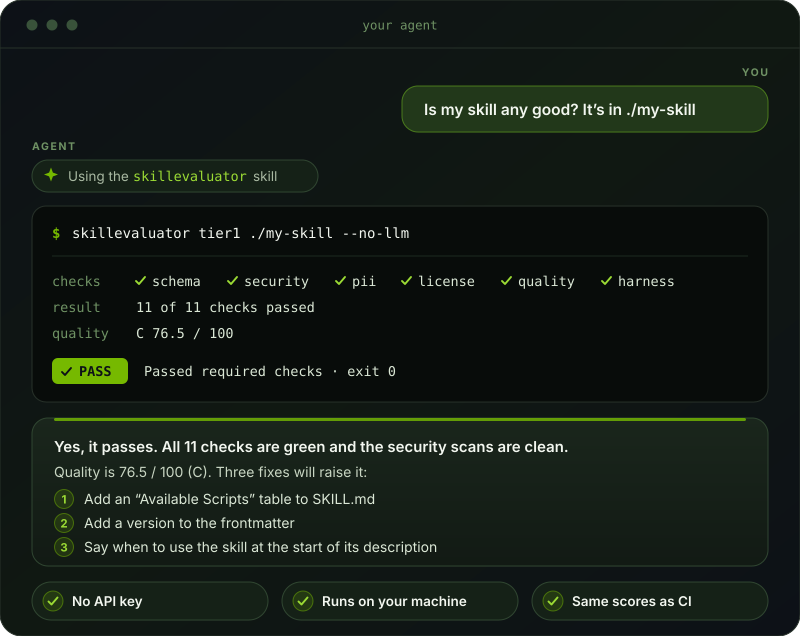
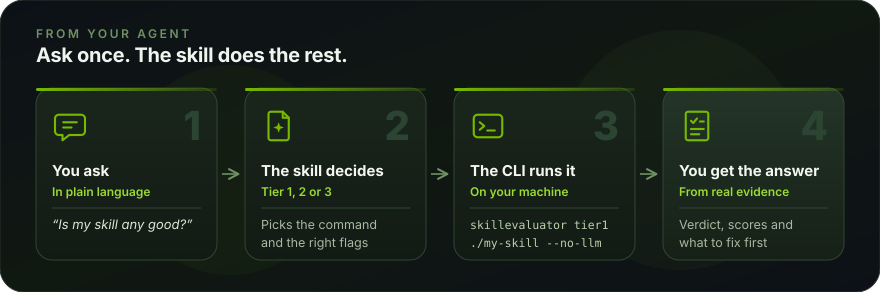

Add one skill to your coding agent, then ask: *"Is my skill any good?"* The agent
picks the right check, runs the `skillevaluator` CLI, reads the report, and tells
you what to fix. No commands or flags to remember.

## Install

<Steps>

### Add the skill with npx

You do this once, in your project. Run the command and pick your agents when it asks:

```bash
npx skills add NVIDIA/SkillEvaluator
```

To add it for one agent only, name the agent:

<Tabs>
  <Tab title="Claude Code">
    ```bash
    npx skills add NVIDIA/SkillEvaluator -a claude-code -y
    ```

    The skill lands in `.claude/skills/skillevaluator`.
  </Tab>
  <Tab title="Codex">
    ```bash
    npx skills add NVIDIA/SkillEvaluator -a codex -y
    ```

    The skill lands in `.agents/skills/skillevaluator`.
  </Tab>
</Tabs>

Either way, it adds the [skill folder](https://github.com/NVIDIA/SkillEvaluator/tree/main/skills/skillevaluator)
to your project. To confirm it is there:

```bash
npx skills list
```

<Accordion title="Don't have npx?">
  `npx` comes with Node.js. [Install Node.js](https://nodejs.org/en/download), then
  run the command above.

  Or skip npx: clone the repository and copy `skills/skillevaluator` yourself.

  ```bash
  git clone --depth 1 https://github.com/NVIDIA/SkillEvaluator.git
  ```

  <Tabs>
    <Tab title="Claude Code">
      ```bash
      cp -r SkillEvaluator/skills/skillevaluator .claude/skills/     # this repository
      cp -r SkillEvaluator/skills/skillevaluator ~/.claude/skills/   # every repository
      ```
    </Tab>
    <Tab title="Codex">
      ```bash
      cp -r SkillEvaluator/skills/skillevaluator .agents/skills/     # this repository
      cp -r SkillEvaluator/skills/skillevaluator ~/.codex/skills/    # every repository
      ```
    </Tab>
    <Tab title="OpenCode">
      ```bash
      cp -r SkillEvaluator/skills/skillevaluator .opencode/skills/            # this repository
      cp -r SkillEvaluator/skills/skillevaluator ~/.config/opencode/skills/   # every repository
      ```
    </Tab>
    <Tab title="OpenClaw">
      ```bash
      cp -r SkillEvaluator/skills/skillevaluator ~/.openclaw/skills/   # every workspace
      ```
    </Tab>
    <Tab title="Other agents">
      Any agent that reads [Agent Skills](https://agentskills.io/) folders works. Copy the folder
      into its skills directory, for example `.cursor/skills`, `.gemini/skills`, or
      `.config/goose/skills`.
    </Tab>
  </Tabs>
</Accordion>

### Install the CLI

The skill folder contains instructions for your agent; the checks run in the
`skillevaluator` CLI. Follow [Installation](/skills/skillevaluator/installation#install)
before asking the agent to run a check. The lightweight installation supports basic checks; choose the
[all-tier option](/skills/skillevaluator/installation#all-tiers) for Tier 2 and Tier 3.

### Start a new agent session

Agents load skills when a session starts, so open a new one in the same project.

### Ask

Ask your agent to check a skill. It uses the CLI you installed in the previous
step.

</Steps>

## Call it

Once the skill is installed, your agent can use it in two ways.

<CardGroup cols={2}>
  <Card title="Just ask" icon="comment">
    Ask in plain language. The agent sees the skill in its list and loads it by itself.
  </Card>
  <Card title="Call it by name" icon="at">
    Name the skill in your request. In Claude Code, typing `/skillevaluator` does the same.
  </Card>
</CardGroup>

```text title="Just ask"
Is my skill any good? It's in ./my-skill
```

```text title="Call it by name"
Use the skillevaluator skill to check ./my-skill
```

<Tip>
  If you have many skills installed, or another one with a similar name, call it by
  name so the agent picks the right one.
</Tip>

## See it work

One question in, one answer out. The agent runs the check for you and needs
no API key.

<Frame caption="An example session. The command and its numbers come from a real run on a small sample skill; your agent's wording will differ.">
  
</Frame>

## How it works

<Frame>
  
</Frame>

The scores come from the CLI, not from the agent's opinion. They match what
you get running SkillEvaluator by hand or in CI.

## What you can ask

| You ask | The agent runs | You get |
| --- | --- | --- |
| "Is my skill any good?" | `skillevaluator tier1 <skill-dir> --no-llm` | Pass or fail, with security, PII, schema, and quality findings |
| "Score the quality of this SKILL.md" | `skillevaluator quality-check` and `rubric-eval` | Quality score and grade, rubric feedback |
| "Does it overlap with my other skills?" | `skillevaluator tier2` | Duplicate and similarity findings |
| "Write eval cases for my skill" | Asks for real tasks and outcomes, writes `<skill-dir>/evals/EVAL.md`, then runs `skillevaluator create-eval-dataset <skill-dir> --full --prompt <skill-dir>/evals/EVAL.md`, then `tier3 validate <skill-dir> --strict` | A reviewed `evals/evals.json` with positive and negative cases |
| "Does my skill actually make the agent better?" | `skillevaluator tier3 evaluate`, with and without the skill | Verdict, five dimension scores, and Skill Lift |
| "Gate skills in our CI" | `skillevaluator ci init` | A setup PR with the right checks |

<Tip>
  The first row needs no key. The rubric, Tier 2, and Tier 3 need one provider key;
  see [Providers & Credentials](/skills/skillevaluator/configuration).
</Tip>

Keyless checks run without asking when their tools are already installed. Before
installing the CLI, an extra or a missing scanner, the agent names the change and
asks for permission unless you already authorized it. It also asks before using
credentials, spending model tokens, or running an agent on your machine. For eval
cases it asks which real tasks matter and what a good result looks like instead
of inventing them. Live evaluation starts separate agent processes and a judge,
so it needs a provider key on the host even when launched from inside your agent.

## Good to know

<AccordionGroup>
  <Accordion title="Which checks need an API key?">
    Static Tier 1 checks need no key. The rubric, Tier 2, and Tier 3 need one provider,
    set in the shell where the agent runs:

    ```bash
    export SKILL_EVAL_LLM_PROVIDER=nv_build
    export NVIDIA_API_KEY=...
    ```

    OpenAI, Anthropic, and any OpenAI-compatible gateway also work. Keys stay in your
    environment; the skill tells the agent never to print or store them.
  </Accordion>
  <Accordion title="What does a live evaluation look like?">
    For "does my skill help", the agent runs the same tasks twice in isolated sandboxes,
    once without your skill and once with it, and an independent judge scores both.

    ```text
    Tier 3 Evaluation: PASS
    Agent: codex   Attempts scored: 32/32

                     Baseline   With skill   Lift
    Overall            82.5%       94.4%    +11.9
    Security           87.5%      100.0%    +12.5
    Correctness        91.3%       98.8%     +7.5
    Effectiveness      68.6%       95.3%    +26.7
    ```

    This is the SkillEvaluator skill evaluated by SkillEvaluator. Its own eval cases
    ship in [`skills/skillevaluator/evals/`](https://github.com/NVIDIA/SkillEvaluator/tree/main/skills/skillevaluator/evals).
    The run above used an earlier version of case 001 that also asserted the agent
    read the skill's `SKILL.md`, which the baseline cannot do; that assertion has
    since been removed.
  </Accordion>
  <Accordion title="Why the agent never grades itself">
    Asking one agent to answer with and without a skill and grade itself is not an
    evaluation. Once it has read the skill, the baseline is contaminated, and the
    same model is judging its own work. The skill always routes "does it help" to
    real Tier 3 runs.
  </Accordion>
  <Accordion title="What runs where?">
    Tier 1 and Tier 2 run on your machine through the CLI, with no Docker. Tier 3 runs
    in a sandbox: Docker by default, or `--env-mode local` for trusted skills. See
    [Agents & Sandboxes](/skills/skillevaluator/agents-and-sandboxes).

    If an attempt errors or times out, the run is INCOMPLETE and no final score is
    reported. The skill tells the agent to say so, find the cause, and rerun, not to
    average partial results.
  </Accordion>
</AccordionGroup>

## Next steps

<CardGroup cols={2}>
  <Card title="Tier 3: Live Agent Evaluation" icon="flask" href="/skills/skillevaluator/tier3-live-evaluation">
    How baseline and with-skill runs are scored, and what Skill Lift means.
  </Card>
  <Card title="Eval Datasets" icon="list-check" href="/skills/skillevaluator/eval-datasets">
    The `evals.json` contract the agent writes and validates.
  </Card>
  <Card title="Reports & Results" icon="chart-column" href="/skills/skillevaluator/reports">
    Every report file the agent reads, and what each field means.
  </Card>
  <Card title="Bring It to Your Repository" icon="code-branch" href="/skills/skillevaluator/repository-integration">
    Check every skill change in GitHub or GitLab CI.
  </Card>
</CardGroup>
