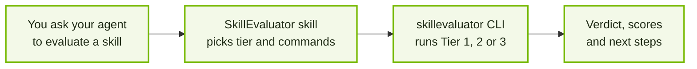

Give your coding agent SkillEvaluator expertise. Install one skill folder, then
ask: *"Is my skill any good?"* The agent picks the right tier, runs the CLI,
reads the report, and tells you what to fix.

No commands to memorize. No flags to look up. The skill ships in the public
repository and stays in sync with the CLI through a test on every change.

## How it works



The skill teaches the agent how to operate SkillEvaluator. The scores still come
from the CLI, its isolated sandboxes, and its independent judge, so results match
what you get running SkillEvaluator by hand or in CI.

<CardGroup cols={3}>
  <Card title="Right check, first time" icon="route">
    Routes "is it safe", "will it trigger", and "does it help" to the matching tier and command.
  </Card>
  <Card title="Honest results" icon="scale-balanced">
    Reads verdicts, exit codes, and INCOMPLETE runs correctly. No scores invented from partial runs.
  </Card>
  <Card title="Fixes, not just scores" icon="wrench">
    Turns findings and `what_to_fix.json` into concrete edits to your `SKILL.md` and eval cases.
  </Card>
</CardGroup>

## Install

<Steps>

### Install the CLI

```bash
pip install --upgrade skillevaluator          # Tier 1 and 2
pip install --upgrade "skillevaluator[all]"   # adds Tier 3 live evaluation
```

See [Installation](installation.mdx) for extras and Python versions.

### Add the skill to your agent

```bash
git clone --depth 1 https://github.com/NVIDIA/SkillEvaluator.git
```

Copy or symlink `SkillEvaluator/skills/skillevaluator` into your agent's skills directory:

<Tabs>
  <Tab title="Codex">
    ```bash
    cp -r SkillEvaluator/skills/skillevaluator .agents/skills/     # this repository
    cp -r SkillEvaluator/skills/skillevaluator ~/.codex/skills/    # every repository
    ```
  </Tab>
  <Tab title="Claude Code">
    ```bash
    cp -r SkillEvaluator/skills/skillevaluator .claude/skills/     # this repository
    cp -r SkillEvaluator/skills/skillevaluator ~/.claude/skills/   # every repository
    ```
  </Tab>
  <Tab title="OpenCode">
    ```bash
    cp -r SkillEvaluator/skills/skillevaluator .opencode/skills/            # this repository
    cp -r SkillEvaluator/skills/skillevaluator ~/.config/opencode/skills/   # every repository
    ```
  </Tab>
  <Tab title="OpenClaw">
    ```bash
    cp -r SkillEvaluator/skills/skillevaluator ~/.openclaw/skills/   # every workspace
    ```
  </Tab>
  <Tab title="Other agents">
    Any agent that reads [Agent Skills](https://agentskills.io/) folders works. Copy the folder
    into its skills directory, for example `.cursor/skills`, `.gemini/skills`, or
    `.config/goose/skills`.
  </Tab>
</Tabs>

### Set a provider key for LLM checks

Static Tier 1 checks need no key. The rubric, Tier 2, and Tier 3 need one provider,
set in the shell where the agent runs:

```bash
export SKILL_EVAL_LLM_PROVIDER=nv_build
export NVIDIA_API_KEY=...
```

OpenAI, Anthropic, and any OpenAI-compatible gateway also work; see
[Providers & Credentials](configuration.mdx). Keys stay in your environment; the
skill tells the agent never to print or store them.

</Steps>

<Tip>
  Start a new agent session after installing so the agent discovers the skill.
</Tip>

## Ask in plain language

| You ask | The agent runs | You get |
| --- | --- | --- |
| "Check my skill before I publish it, no API keys" | `skillevaluator tier1 <skill-dir> --no-llm` | Pass or fail with security, PII, schema, and quality findings |
| "Score the quality of this SKILL.md" | `skillevaluator quality-check` and `rubric-eval` | Quality score and grade, rubric feedback |
| "Does it overlap with my other skills?" | `skillevaluator tier2` | Duplicate and similarity findings |
| "Write eval cases for my skill" | Write task requests and outcomes in `<skill-dir>/evals/EVAL.md`, run `skillevaluator create-eval-dataset <skill-dir> --full --prompt <skill-dir>/evals/EVAL.md`, then `tier3 validate <skill-dir> --strict` | A reviewed `evals/evals.json` with positive and negative cases |
| "Does my skill actually make the agent better?" | `skillevaluator tier3 evaluate` with and without the skill | Verdict, five dimension scores, and Skill Lift |
| "Explain this benchmark report" | Reads `result.json`, `tier3-benchmark.md`, `what_to_fix.json` | Plain-language verdict and prioritized fixes |
| "Gate skills in our CI" | `skillevaluator ci init` | A workflow with the right exit-code gates |

## What a live evaluation looks like

For "does my skill help", the agent runs the same tasks twice in isolated
sandboxes, once without your skill and once with it, and an independent judge
scores both.

```text
Tier 3 Evaluation: PASS
Agent: codex   Attempts scored: 32/32

                 Baseline   With skill   Lift
Overall            82.5%       94.4%    +11.9
Security           87.5%      100.0%    +12.5
Correctness        91.3%       98.8%     +7.5
Effectiveness      68.6%       95.3%    +26.7
```

This is the SkillEvaluator skill evaluated by SkillEvaluator. Its own eval cases
ship in [`skills/skillevaluator/evals/`](https://github.com/NVIDIA/SkillEvaluator/tree/main/skills/skillevaluator/evals).
The run above used an earlier version of case 001 that also asserted the agent
read the skill's `SKILL.md`, which the baseline cannot do; that assertion has
since been removed.

<Warning>
  Asking one agent to answer with and without a skill and grade itself is not an
  evaluation. Once it has read the skill, the baseline is contaminated, and the
  same model is judging its own work. The skill always routes "does it help" to
  real Tier 3 runs.
</Warning>

## What runs where

<AccordionGroup>
  <Accordion title="Tier 1 and Tier 2: on your machine">
    Static checks, quality, security, PII, and deduplication run locally through the CLI.
    No Docker and no Harbor. LLM-assisted checks need a provider key.
  </Accordion>
  <Accordion title="Tier 3: in a sandbox">
    Docker is the default backend; SkillEvaluator drives Harbor for you. For trusted skills,
    `--env-mode local` runs the agent on the host under Bubblewrap (Linux) or Seatbelt (macOS).
    See [Agents & Sandboxes](agents-and-sandboxes.mdx).
  </Accordion>
  <Accordion title="Incomplete runs">
    If an attempt errors or times out, the run is INCOMPLETE and no final score or lift is
    reported. The skill tells the agent to say so, find the cause, and rerun, not to average
    the partial results.
  </Accordion>
</AccordionGroup>

## Next steps

<CardGroup cols={2}>
  <Card title="Tier 3: Live Evaluation" icon="flask" href="tier3-live-evaluation.mdx">
    How baseline and with-skill runs are scored, and what Skill Lift means.
  </Card>
  <Card title="Eval Datasets" icon="list-check" href="eval-datasets.mdx">
    The `evals.json` contract the agent writes and validates.
  </Card>
  <Card title="Reports & Results" icon="chart-column" href="reports.mdx">
    Every report file the agent reads, and what each field means.
  </Card>
  <Card title="Bring It to Your Repository" icon="code-branch" href="repository-integration.mdx">
    Check every skill change in GitHub or GitLab CI.
  </Card>
</CardGroup>
