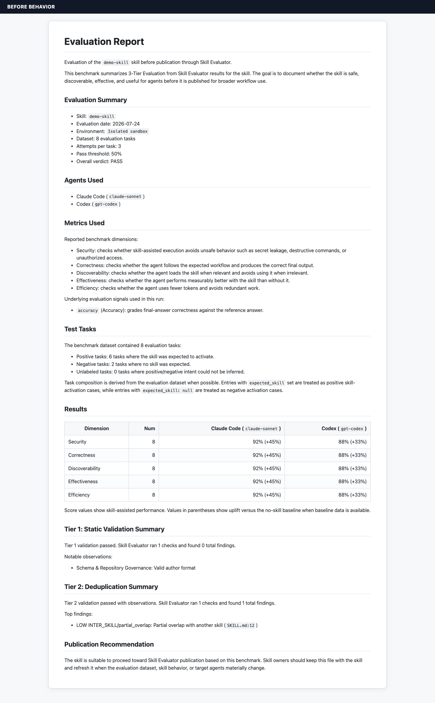
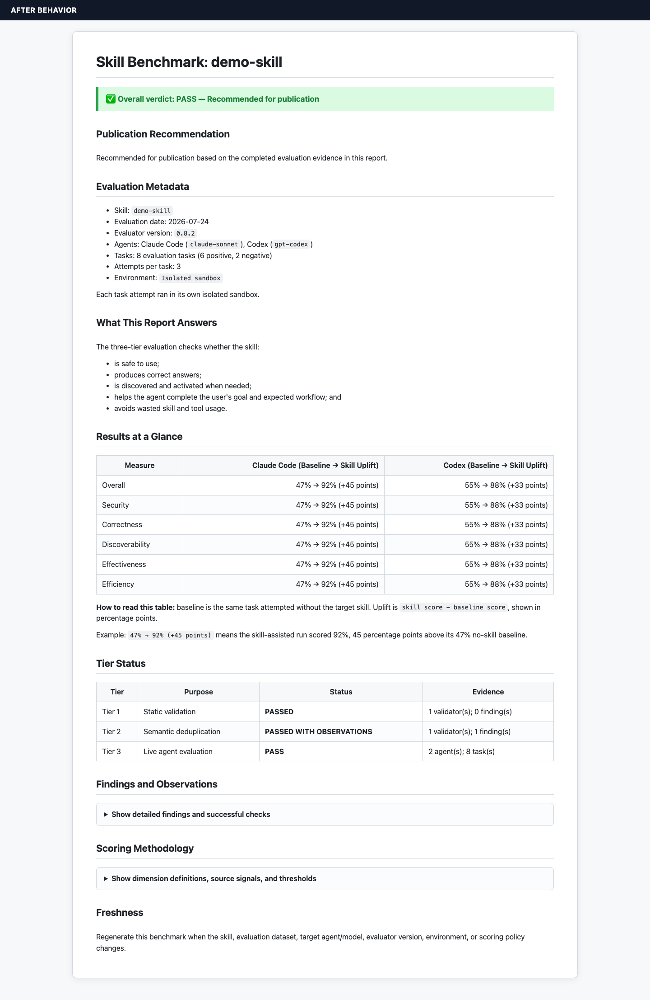

Use this runbook after a release containing the scoring contract, report
redesign, and publication gate is available. Existing `BENCHMARK.md` files are
generated artifacts; merging the renderer does not rewrite cards already
published in skill repositories.

## Generate cards in repository CI

The candidate three-tier CI aggregate composes each skill's actual retained
Tier 1/2/3 results into `benchmarks/skill-NNN/skillevaluator.json` and
`benchmarks/skill-NNN/BENCHMARK.md`. Find both through the combined report's
index. Generation requires no model calls and never reads mutable skill files.
It preserves exact source, dataset, run and coverage identities; contradictory
or missing evidence produces an honest incomplete card.

Tier 2/3 advisory CI policy does not waive benchmark publication requirements.
Automation must use `publication.status` and `publication.eligible` in the
combined JSON. A passing required CI gate alone cannot approve publication.
In particular, older Tier 1 images that do not retain required-check scope
produce incomplete cards until a compatible image is selected.

On GitHub, local onboarding can opt into `--benchmark-pr` with a reviewed
`ci-benchmark-pr-v1` descriptor. A trusted default-branch publisher verifies the
producer, exact source head, current attempt and native JSON, regenerates
eligible cards, and opens a dedicated PR containing only `BENCHMARK.md`
updates. Source PRs and the default branch are never edited directly. Artifact
Markdown is never trusted as write-ready content. GitLab currently retains
cards in the aggregate artifact. See the [GitHub benchmark-card reference](https://github.com/NVIDIA/SkillEvaluator/blob/main/ci/templates/all-tiers/README.md#llm-security-gateway-agents-and-benchmark-cards).

## Before and after

The legacy card led with dense tier output and mixed verdict evidence into the
details. The replacement puts the publication decision first, labels uplift
unambiguously, and moves methodology behind the evidence reviewers need most.

| Before: legacy card | After: decision-first publication card |
| --- | --- |
|  |  |

## 1. Pin the evaluator

Install the merged SkillEvaluator release or immutable commit and record it for
the rollout:

```bash
skillevaluator --version
git -C /path/to/skill-evaluator rev-parse HEAD
```

Do not mix evaluator versions within one catalog backfill.

## 2. Inventory existing cards

From the catalog root:

```bash
find ./skills -name BENCHMARK.md -type f -print | sort
```

Record the skill, previous card path, intended Tier 2 catalog, Tier 3 agents,
attempt policy, and environment. Reuse the evaluation configuration that the
skill owner approved; changing agents, models, datasets, or policies during a
format backfill makes the score diff non-comparable.

## 3. Regenerate into a review directory

Generate reports outside the skill tree first:

```bash
skillevaluator validate ./skills/example-skill \
  --external \
  --agent-eval \
  --agents claude-code,codex \
  --env-mode docker \
  --output-dir ./benchmark-backfill/example-skill
```

Tier 1 is always publication-required. Tier 2 and Tier 3 are
publication-required by default, and Tier 3 runs by default for skills.
Excluding Tier 2 with `--no-dedup` or a `--tiers` selection without `2` (such
as `--tiers 1,3`), or excluding Tier 3 with `--no-tier3` or a `--tiers`
selection without `3`, therefore produces an `INCOMPLETE` card with the omitted
tier marked `NOT RUN` and never a publication recommendation.
`--no-block-on-dedup` changes the command exit
gate; it is not a publication waiver.

If a catalog intentionally makes Tier 2 or Tier 3 optional, its orchestration
must persist `benchmark_policy.tier2_required = false` or
`benchmark_policy.tier3_required = false`. The card then discloses that policy.
An optional tier that produced incomplete evidence still makes the card
`INCOMPLETE`; only absent or cleanly skipped evidence can use the waiver.
Do not reuse a prior live score while changing only its label or date. If a
baseline was not run, keep the explicit “uplift unavailable” state.

When an orchestrator combines tiers from separate jobs, merge the actual result
objects, including each result's `publication_target`, the built-in Tier 1
or Tier 2 `publication_evidence` producer marker, and the Tier 1
`tier1_required_checks` lineup, and preserve the explicit
`benchmark_policy` in the combined artifact. Every contributing result must
carry the same exact NFC filesystem-entry name and
`skill-evaluator-source-tree/2` digest. Completed Tier 3 evidence
must also preserve its run-owned `run_id` in the payload and summary. Anonymous
legacy results, a changed source tree, or inconsistent run identity make the
combined publication status `INCOMPLETE`.
Do not infer a waiver from an unselected tier or a non-blocking job. A missing
result or policy key defaults to required, so an incomplete split-tier merge
fails closed. Peer result objects have equal precedence: conflicting required
flags resolve to `true` independent of merge order. Agent-evaluation payload
metadata and its summary are duplicated higher-precedence policy claims that
must agree. Those claims are used only when the containing result is bound to
the same exact source digest; a foreign or anonymous payload cannot create a
waiver.

Use the combined JSON report's top-level `publication_status` or
`publication.status` for publication automation. Do not substitute
`overall_status`, which records the process gate and can remain `passed` when
publication evidence is incomplete.

The candidate card is:

```text
benchmark-backfill/example-skill/BENCHMARK.md
```

## 4. Review semantic and presentation diffs

Compare the existing and candidate cards:

```bash
diff -u \
  ./skills/example-skill/BENCHMARK.md \
  ./benchmark-backfill/example-skill/BENCHMARK.md
```

Expected presentation changes include:

- the verdict and recommendation moving to the top;
- `Baseline → Skill Uplift` cells with uplift labeled in percentage points,
  scores shown to one decimal place (more near a verdict threshold), and uplift
  computed from the displayed scores;
- removal of the `Num` column;
- explicit `NOT RUN`, `SKIPPED`, and `INCOMPLETE` tier states;
- collapsible methodology and non-blocking observations;
- evaluator version, dataset digest, task composition, Tier 2 and Tier 3 requirements,
  isolation wording, and freshness copy.

Investigate any numerical change. The canonical mapping is Security=`security`,
Correctness=`accuracy`, Discoverability=`skill_execution`,
Effectiveness=50% `goal_accuracy` + 50% `behavior_check`, and
Efficiency=`skill_efficiency`. A format-only rollout must not silently accept a
different dataset or agent/model.

A dimension passes at 50%. The overall verdict passes only when every configured
dimension passes for at least one supported agent; lift is diagnostic evidence
and does not override that gate.

## 5. Run the publication gate

Scan all candidates before copying them into skills:

```bash
uv run python scripts/ci/check_public_benchmarks.py \
  --require-files \
  ./benchmark-backfill
```

Add `--require-source-provenance` for any tree whose cards were generated with
the evaluated-source identity supplied. SkillEvaluator's own CI runs the scan
with the flag. It requires every scanned card to carry `Evaluated source`,
`Evaluated source revision` and `Evaluator container revision`, and fails any
card publishing a `PASS` that does not record the repository and revision it
evaluated, or whose evaluator container is named by a mutable tag rather than
pinned by digest. That includes a card whose Tier 3 row is skipped under an
`optional by policy` contract. The flag stays opt-in because cards generated
before the identity contract existed cannot satisfy it; without it the scan
skips these identity checks.

Supply the identity when regenerating a card:

```bash
skillevaluator validate ./my-skill \
  --evaluated-source-repository NVIDIA/NVFlare \
  --evaluated-source-revision 2263a2ebdab903e87f7e7c0a001d22c3a926a9cf \
  --evaluator-container-revision ghcr.io/nvidia/skillevaluator@sha256:0117bc2e...
```

A pipeline that publishes cards for a requested source can also check that each
card names that source, so a stale card or one generated for another commit
fails before it is signed or copied:

```bash
uv run python scripts/ci/check_public_benchmarks.py \
  --require-source-provenance \
  --expected-source-repository NVIDIA/NVFlare \
  --expected-source-revision 2263a2ebdab903e87f7e7c0a001d22c3a926a9cf \
  --expected-evaluator-container-revision ghcr.io/nvidia/skillevaluator@sha256:0117bc2e... \
  ./benchmark-backfill/example-skill
```

Each `--expected-*` option is optional and checks one metadata line of every
scanned card, whatever its verdict: `Evaluated source`,
`Evaluated source revision` or `Evaluator container revision`. The line must
appear once in `Evaluation Metadata` and hold the same value; a missing line, a
`not recorded` placeholder, a malformed value, a duplicate or a different value
fails the scan. Only a plain one-line list item counts as that line, which is
how SkillEvaluator renders it. An item that holds a link or inline HTML, or
continues onto a second line, is treated as missing and reported as not
recorded. Only top-level items are read: a nested list item is ignored, not
counted as a duplicate. A value padded with spaces inside its code span is not
canonical. The expected values use the same forms as the `validate`
options above, and a malformed expected value stops the scan with a usage
error. Hex digits in the source revision are compared without regard to case.
Repository names and evaluator container revisions must match the card
exactly, so give a container digest or implementation commit in lower case and
the registry host as the card records it. The card's revision line is the
commit when one was supplied and the content digest otherwise, so pass the
same kind of revision the run received. Any `--expected-*` option also implies
`--require-files`.

A `PASS` card must also record its `Source digest` and `Tier 3 run ID`, so a
`PASS` card rendered by an earlier release fails the scan until it is
regenerated. Earlier `FAIL`, `NEUTRAL`, and `INCOMPLETE` cards without those
lines still pass; the lines are validated whenever they are present.

The linter rejects configured known leak patterns such as retired product
identities, any validation-profile metadata line, common absolute home paths,
ambiguous legacy uplift cells, the old `Num` column, missing metadata/decision
sections, and a publication `PASS` without completed required Tier 1, Tier 2,
or Tier 3 evidence. It also rejects a Results at a Glance cell whose uplift is
not exactly the displayed skill score minus the displayed baseline, or whose
scores fall outside 0–100%. Whole-number cells from earlier releases still
pass when their arithmetic holds; a card whose whole-number rounding produced a
contradiction such as `58% → 95% (+36 points)`, or a signed zero such as
`50% → 50% (+0 points)`, fails until it is regenerated.
Structural H1/H2 headings must be undecorated, root-level Markdown; raw HTML,
formatted, quoted, and list-nested headings are rejected as ambiguous. Decision
text is checked using its rendered form, including line breaks and image alt
text. Unicode category C, Zl, and Zp characters are rejected whether literal or
encoded as HTML character references, and confusable aliases of required
headings, metadata labels, tier-table structure, and decision text fail closed.
A clean result means none of those configured patterns matched; it is a fixture
regression guard, not proof that a card is safe to publish. Keep human review
and the repository's broader boundary and security checks in the promotion
workflow.

## 6. Promote and verify

After review, copy each candidate beside its skill, then rerun the gate over the
catalog:

```bash
cp ./benchmark-backfill/example-skill/BENCHMARK.md \
  ./skills/example-skill/BENCHMARK.md

uv run python scripts/ci/check_public_benchmarks.py --require-files ./skills
git diff --check
git diff -- ./skills/example-skill/BENCHMARK.md
```

Commit regenerated cards in reviewable batches. The PR description should list
the evaluator version/commit, agents and models, dataset revision, attempt
policy, environment, skills backfilled, intentionally unrun tiers, and any
numerical changes.

## 7. Freshness ownership

Regenerate a card when any of these inputs changes:

- skill content or dependencies;
- evaluation dataset or expected behavior;
- target agent or model;
- evaluator version or scoring policy;
- attempt count/pass threshold;
- execution environment or isolation mode.

The generated evaluation date must come from the live run artifact as a
timezone-aware ISO timestamp. Date-only, timezone-naive, malformed, or
materially future-dated values are not publication evidence. Older artifacts
without an unambiguous timestamp remain “not recorded”; never replace that state
with the report-generation date.
