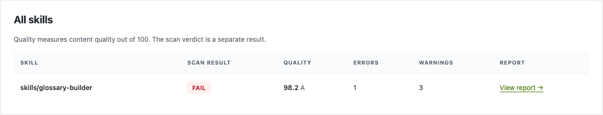

Bring skill evaluation to your GitHub repository with one workflow file.
Choose your skill folders; pull requests check changed skills automatically.
The shared image includes **Tier 1 and SkillSpector security scanning**.

<CardGroup cols={2}>
  <Card title="Use the CLI" icon="terminal" href="/skills/skillevaluator/cli-onboarding">
    Answer a few questions. The CLI prepares checks, optional hosted feedback and a setup PR.
  </Card>
  <Card title="Copy the workflows" icon="file-code" href="#get-started">
    Copy the ready-to-use templates. No local CLI installation required.
  </Card>
</CardGroup>

## Three-tier checks and feedback

The opt-in [CLI setup](cli-onboarding.mdx#opt-in-to-three-tier-ci) creates
`.github/workflows/skill-checks-all-tiers.yml` and
`.github/workflows/feedback-all-tiers.yml`. This unreleased path needs a reviewed
capability-bearing descriptor; the 0.7.2 downloads below remain Tier 1 only.
The [candidate source templates](https://github.com/NVIDIA/SkillEvaluator/tree/main/ci/templates)
contain placeholders and must be filled with reviewed immutable references.

The evaluation workflow calls the existing hardened Tier 1 container workflow
at the same evaluator revision. Tier 2 and Tier 3 run independently with
`fail-fast: false`, Python 3.12, and only their tier's installed extras. Native
evaluator tools come from the pinned tools commit, while the candidate is
checked out separately at the exact PR head. Provider-backed jobs require the
current same-repository PR head or current default-branch commit, plus proven
write, maintain, or admin repository permission for the initiating actor.
Both actor permission and commit freshness are checked again before secrets
are used. Environment-scoped provider secrets in `skillevaluator` are
recommended; explicit mappings from repository CI secrets are also supported.
Reviewers are optional: repositories can add an approval rule when they want one, while
automatic execution does not depend on that GitHub plan feature. Protect
repository and CI workflow write access as part of maintaining this boundary.
Fork PRs retain keyless Tier 1 evidence. Provider-backed Tier 2/3 execution needs
an eligible same-repository run; unavailable evidence remains advisory and visible.

The aggregate job always runs, and only Tier 1 determines its required result.
Tier 2 and Tier 3 remain advisory when they fail or are incomplete; their native
statuses and reports remain visible. The deprecated `tier3-required` input is
ignored, including when set to `true`; it cannot make Tier 3 block CI. Keep the
aggregate check required in branch protection to enforce Tier 1, and review its
actual check name in a completed run. Reports are retained for 14
days in `skill-evaluator-results-attempt-N`, including failed and incomplete
results, with each tier's native JSON and HTML. **Re-run failed jobs** reuses
the latest evidence from tier jobs that were not rerun, and records each tier's
producing attempt as `source_attempt`. Artifact download links require
normal repository access; they do not create public report hosting.

The feedback workflow starts from `workflow_run` on the default branch. It
checks out only pinned trusted tools, validates the producer and current PR
head, and updates one comment with a single summary table. Each skill has
one-line results for Static and Security Validation, Deduplication, and Live
Agent Evaluation, plus one **Report** link to the exact run's combined private
artifact. The lines show status, recorded issue count and the main finding or
blocker; incomplete or missing evidence shows an unknown count. Download and
extract the artifact, then open `index.html` for the detailed aggregate and
native reports. See the
[comment and report contract](reports.mdx#retained-three-tier-ci-evidence).
The workflow never checks out the candidate with a write token. Merge this feedback file
onto the default branch before expecting the first automatic comment. Changes
to the caller must refresh its approved Git blob in `trusted-caller-blobs`.

A missing provider key, unavailable runtime, or missing committed native dataset
must remain visible as an incomplete or needs-action result. Local `ci init`,
`ci status`, and `ci demo` are setup and inspection commands; a successful setup
is not evidence that the three tiers passed. Optional Pages hosting remains a
separate opt-in; artifact feedback works without it.

## Get started

The scanner uses one **default validation policy** for public and private
repositories. There is no `internal`/`external` workflow input. Older images call
this same policy `external`; that label does not publish your repository or reports.

<Steps>

### Copy the ready-to-use template

Open [skill-checks.yml](https://github.com/NVIDIA/SkillEvaluator/blob/main/ci/bundles/0.8.0/skill-checks.yml)
from the [ready-to-use templates](https://github.com/NVIDIA/SkillEvaluator/tree/main/ci/bundles/0.8.0).
Use GitHub's **Raw** view to copy it into `.github/workflows/skill-checks.yml`.
The template already supplies pinned workflow and image versions.

### Point it at your skills

Edit these inputs in the downloaded file:

```yaml title="Your choices in skill-checks.yml"
with:
  paths: |-
    skills
    .agents/skills
  min-score: 70
  scan-mode: auto
  llm: false
```

Use your own skill folders. Keep `auto` to scan changed skills in PRs;
`all` checks the configured collection. If your default branch is not `main`,
update the template's push branch.

### Commit the workflow and open a skill PR

Merge the workflow onto your default branch, then open a PR changing a selected
skill. GitHub Actions must be enabled and allowed to use the referenced
reusable workflow and actions.

</Steps>

<Note>
  The released template provides **checks and downloadable reports**.
  Hosted reports and PR comments need the [optional publisher setup](#enable-pr-comments).
  The same release also includes the optional publisher template.
</Note>

<Accordion title="I prefer to inspect the source templates">
  Browse the public [template catalog](https://github.com/NVIDIA/SkillEvaluator/blob/main/ci/templates/README.md)
  and [skill-checks.yml source](https://github.com/NVIDIA/SkillEvaluator/blob/main/ci/templates/skill-checks.yml).
  Source templates contain placeholders. Use the release-generated file when
  onboarding; do not substitute `main` or `latest` for its immutable versions.
</Accordion>

## See what happened

| Start here | Then open |
| --- | --- |
| **PR → Checks** | The `skills / Tier 1 scan` result and its short summary. |
| **Actions → Skill checks** | The run and downloadable report artifact. |
| **PR → Conversation**, with publishing enabled | The updated bot comment and **Open full report** link. |

Download `skill-evaluator-tier1-attempt-N`, extract it, and open `index.html`.
Failed scans retain their available reports too. The HTML separates the
**verdict** from the **quality score**: a high score does not override a failed
required security or schema check.

<Frame caption="Report example: the skill scored 98.2 but did not meet a configured 100-point threshold. The shared renderer is used by both GitHub and GitLab.">
  
</Frame>

### On the pull request

With publishing enabled, one bot comment is updated for new results. Reviewers
see the issue and next step without reading the full Actions log.

<Frame caption="Shortened illustrative PR comment. Real comments link to your report and workflow run.">
<div style={{ padding: "16px", width: "100%", minWidth: 0 }}>

**github-actions[bot]**

**Tier 1 scan result: FAILED**

1 skill · 0 passed · 1 failed · 0 incomplete

| Skill | Status | Quality / 100 |
| --- | --- | --- |
| `skills/glossary-builder` | FAIL | 98.2 / A |

**Problem:** Quality score 98.2/100 is below the required 100/100.

**Next step:** Open the skill report and address its quality findings.

**Open full report** · **View workflow run**

</div>
</Frame>

Browse the [public report and log examples](https://github.com/NVIDIA/SkillEvaluator/blob/main/ci/examples/README.md)
for more detail. No personal demo-repository access is needed.

## Enable PR comments

The optional publisher hosts the HTML and posts a comment **after deployment
succeeds**. It needs a second workflow plus one-time hosting and approval settings.

<Card title="Try the guided setup" icon="terminal" href="/skills/skillevaluator/cli-onboarding">
  The CLI recognizes an existing single-job scan, keeps its settings and
  component version tag, and adds reporting in a setup PR. New repositories
  get both workflows.
</Card>

Copy [publish-skill-reports.yml](https://github.com/NVIDIA/SkillEvaluator/blob/main/ci/bundles/0.8.0/publish-skill-reports.yml)
from the same template folder as your scan workflow. Complete the one-time setup below,
or let the [CLI](/skills/skillevaluator/cli-onboarding) handle it.

<AccordionGroup>
  <Accordion title="What does manual publisher setup involve?">
    Start with the filled-in publisher template and follow the
    [publisher setup guide](https://github.com/NVIDIA/SkillEvaluator/blob/main/ci/README.md#optional-hosted-reports-and-pr-feedback).
    The main steps are:

    1. Enable **Settings → Pages → Source: GitHub Actions** and initialize the
       `gh-pages` report-history branch. For private reports, an administrator
       must also select **Private** site visibility in GitHub's settings; see
       the private-hosting requirements below. Preserve any existing site or history.
    2. Add `publish-skill-reports.yml` with your Pages URL. Keep the evaluator
       and publisher versions supplied by the release.
    3. Grant the scan workflow `id-token: write`, then approve its exact contents
       in the publisher's `trusted-caller-blobs` input. Compute the value with
       `git hash-object .github/workflows/skill-checks.yml`; refresh it whenever
       that scan file changes.
    4. Merge both workflow files into the default branch. Open a new skill PR
       to test checks, hosting and feedback together.

    Keep the **Skill checks** workflow name, scan filename and default artifact
    name. The publisher uses GitHub's automatic token; organization policies
    must allow its permissions and referenced actions. Copying a second file
    alone does not finish setup.
  </Accordion>
  <Accordion title="Who receives a comment, and who can read the report?">
    Comments are posted on open, current-head PRs from branches in the same
    repository. Fork-origin PRs keep their available reports in Actions.
    Pages is public unless explicitly configured as private; repository privacy
    alone does not make its Pages site private. Reports may contain source
    excerpts and unmerged findings. Use downloadable artifacts when public
    hosting is unsuitable.
  </Accordion>
  <Accordion title="Can our private repository publish private reports?">
    Access-controlled Pages requires a private or internal project repository
    owned by a GitHub Enterprise Cloud organization. An administrator first
    selects **GitHub Actions** and **Private** in **Settings → Pages**. The
    REST API cannot set Pages visibility. Personal repositories cannot host
    private Pages.

    The CLI verifies the existing private site and uses its assigned
    `*.pages.github.io` URL. It accepts an existing SkillEvaluator report site
    or a newly configured empty private site, and preserves unrelated websites.
    If private hosting is unavailable, choose checks only. See
    [private report hosting](cli-onboarding.mdx#private-report-hosting) for the
    guided path and [GitHub's access-control requirements](https://docs.github.com/en/enterprise-cloud@latest/pages/getting-started-with-github-pages/changing-the-visibility-of-your-github-pages-site).
  </Accordion>
</AccordionGroup>

## Fit it into your workflow

<AccordionGroup>
  <Accordion title="Will this wait for my existing workflows?">
    This workflow runs independently. Existing workflows remain separate; it
    does not automatically wait for them to finish. Configure explicit workflow
    dependencies if your pipeline needs that ordering.
  </Accordion>
  <Accordion title="Which changes trigger a scan?">
    `auto` selects affected skills on pull requests. Pushes to the default
    branch and manual runs scan the configured collection. `all` scans that
    collection each time. No changed skills is a successful **Skipped** result,
    not a scanner pass. Changes to shared files outside the skill roots are not
    inferred dependencies; use `all` when they should trigger a full scan.
    Selection is capped at 100 skills. Timeouts retain completed results and
    mark unfinished work incomplete. The workflow scans up to four skills at
    once; `scan-workers` accepts 1–16.
  </Accordion>
  <Accordion title="How do I make this a merge gate?">
    After the first run, select its scan check in GitHub branch rules. The
    current template emits `skills / Tier 1 scan`; use the actual check name
    shown in your repository. `min-score` sets the quality threshold; required
    security, schema and other checks remain independent. This integration
    runs Tier 1 only.
  </Accordion>
  <Accordion title="The scan finished, but the comment is missing">
    Confirm setup is on the default branch and the PR is eligible for comments.
    Open **Publish skill reports** to see whether deployment completed. If
    hosting was skipped, check the scan's `id-token: write` permission and
    `trusted-caller-blobs` value. A new scan must use the updated workflow;
    rerunning an old job keeps its original workflow. The scan's downloadable
    report remains a separate way to inspect available findings.
  </Accordion>
  <Accordion title="Our organization uses a shared workflow wrapper">
    Keep the component reference in your existing caller, for example
    `your-org/ci/.github/workflows/skill-checks.yml@v3`, then run
    `skillevaluator ci init` in each consumer repository. The CLI recognizes
    `.github/workflows/skill-checks.yml` with the name **Skill checks** and one
    reusable scan job. It preserves inputs, triggers and the version tag while
    adding the publisher and any needed scan-job `id-token: write` permission.

    The component maintainer must first grant `id-token: write` in the job
    calling the evaluator. The CLI checks that prerequisite before applying
    reporting setup; a consumer permission alone cannot grant it downstream.

    With delegation, the publisher approves the exact component path and tag
    in `trusted-wrapper-workflows` and `delegated-evaluator-wrapper`. Updating
    `v3` then updates future scans centrally, with no consumer workflow edit.
    Published execution receipts record the resolved component and evaluator
    commit SHAs for each run. The component still pins its evaluator and image
    immutably. Use a full component SHA when you want to hold that version fixed.

    Use SkillEvaluator 0.7.2 or later and its reviewed publisher for these delegation inputs; the
    archived 0.7.1 publisher does not. Direct callers keep an immutable
    evaluator approval. For manual configuration, follow the
    [shared-workflow setup](https://github.com/NVIDIA/SkillEvaluator/blob/main/ci/README.md#calling-through-a-shared-workflow)
    guide. PR comments follow successful report deployment; private reports
    require the private Pages setup described above.
  </Accordion>
  <Accordion title="Do the checks need an LLM key or network access?">
    Default Tier 1 checks use no model key. Dependency audits can contact
    vulnerability services and submit package metadata; packages are not
    installed and build scripts are not run. Optional LLM checks use a separate
    [manual workflow](https://github.com/NVIDIA/SkillEvaluator/blob/main/ci/templates/skill-checks-llm.yml),
    your provider key and provider charges. They send selected content to that
    provider and are outside the default publisher allowlist.
  </Accordion>
</AccordionGroup>

<CardGroup cols={2}>
  <Card title="Set up with the CLI" icon="terminal" href="/skills/skillevaluator/cli-onboarding">
    See the guided setup and try your first test PR.
  </Card>
  <Card title="GitLab CI/CD" icon="code-branch" href="/skills/skillevaluator/gitlab-ci">
    Use the shared scanner image with a GitLab pipeline.
  </Card>
</CardGroup>
