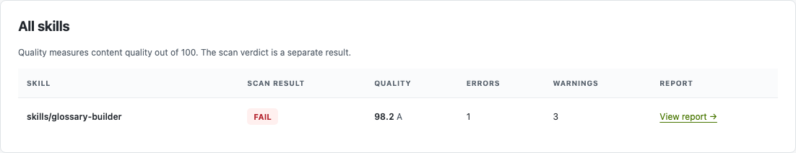

Bring skill evaluation to GitLab with a reusable CI job. Point it at your skills
and choose a quality threshold; merge requests evaluate changed skills
without installing scanners or adding evaluation code to your repository.
The shared container includes SkillSpector security scanning.

## Three-tier checks and feedback

This path requires **GitLab 17.0 or later** for validated include inputs.
The unreleased [all-tier CLI path](cli-onboarding.mdx#opt-in-to-three-tier-ci)
creates two thin files: `.gitlab-ci.yml` includes the pinned shared evaluation
configuration, and `.gitlab/skill-feedback.yml` includes pinned trusted feedback.
Use a schema-version 2 descriptor declaring `all-tiers-gitlab`; released 0.7.2
configurations below remain Tier 1 only. Merge with any existing root workflow
rules and stages, retaining rules that allow merge-request pipelines.

The shared configuration runs the pinned Tier 1 image plus parallel native
Tier 2 and Tier 3 jobs. Tier 1 and Tier 2 are required, while Tier 3 is advisory
unless `SKILL_EVAL_TIER3_REQUIRED` is `true`. Native execution jobs can retain
failed outcomes without stopping their parallel sibling; the aggregate is the
required merge gate and fails for every failed or missing required tier.
The always-running aggregate job
retains `skill-evaluator-results/ci-results.json`, `index.html`, `summary.md`,
and each tier's native reports for 14 days. Reports stay behind your normal
GitLab artifact access controls.

Configure a runner matching `SKILL_EVAL_RUNNER` (default `docker`), the protected
`SKILL_EVAL_ENVIRONMENT` (default `skillevaluator`) and provider secrets scoped
to that execution environment. The default Docker service needs a privileged
runner with Docker-in-Docker enabled. Docker mode also requires the Docker CLI,
Compose v2 and Buildx; the shared job installs these clients in supported root
Linux containers and checks readiness before evaluation. For local mode the generated caller
removes that service; use a Linux or macOS native runner with Python 3.12,
Git and Node/npm. Missing native tools must be installed by the runner
administrator; system-package bootstrap is limited to root Linux containers. The
trusted tools are installed from `SKILL_EVAL_TOOLS_REF`, an immutable commit.
Local agent CLIs are pinned and bootstrapped before selected-mode readiness
checks. The current same-project MR head is checked before model execution;
fork MRs do not receive provider-backed jobs.

GitLab 17.0–18.3 requires a separate project access token with **Reporter** role
and **read_api** scope for current-MR admission. Store it as masked
`SKILLEVALUATOR_GITLAB_READ_TOKEN`, scoped only to the configured execution
environment (`skillevaluator` by default). Protect that environment to approved CI maintainers. For ordinary
unprotected MR branches, the variable must be available on those refs; enabling
GitLab's protected-variable restriction would withhold it. The admission helper
uses this read credential once, refuses HTTP redirects, and the job removes it
before runtime installation, doctor or provider execution.

GitLab 18.4 and later support the default short-lived `CI_JOB_TOKEN` path for
this MR endpoint; the separate read token remains optional. `ci init --mode pr`
and `ci status` check the server version through the local authenticated API.
Offline preview/save keep the version unverified. These local commands report
the prerequisite and do not claim to validate a stored CI secret's privileges.
The setup still consists of two consumer files.

Protect the default branch and create a project access token with `api` scope
and the Maintainer role. The publisher reads source-pipeline variables to verify
provenance as well as reading artifacts and updating MR notes; GitLab 17.8
rejects the variables request for a Developer token. Store the token as masked, protected
`SKILLEVALUATOR_GITLAB_TOKEN`, scoped only to the protected
`skillevaluator-feedback` environment. The MR pipeline never receives that
token. After aggregation, a small job uses its short-lived `CI_JOB_TOKEN` with
GitLab's pipeline trigger API to request a separate pipeline on the protected
default branch. It sends only `SKILL_EVAL_FEEDBACK=true` and the source pipeline
ID, without forwarding repository variables or caller-supplied pipeline overrides.
GitLab also adds its own `TRIGGER_PAYLOAD` file variable. The publisher accepts
that bounded file entry alongside the two selectors and treats its contents as
opaque; additional caller variables remain disallowed.
The API supports same-project pipelines; GitLab's declarative multi-project
bridge rejects a target in the same project. That trusted pipeline uses validated include inputs for fixed evaluator pins,
API host and project, so forwarded MR variables cannot replace its privileged
bootstrap. It fetches only pinned evaluator tools and authenticates the server's
upstream pipeline and source job relationship, then validates the source
configuration, aggregate artifact, MR and current commit before updating one
comment. The initiating pipeline user must be allowed to create a pipeline on
the protected default branch, pass the two pipeline variables and run the
protected feedback environment. Configure these permissions for authorized CI
maintainers; a job token does not bypass protected-branch or deployment permissions.
The feedback request is advisory; the aggregate remains the required evaluation
gate when the first setup MR has not yet installed feedback on the default branch.

Install both configuration files on the default branch before the first demo
MR. GitLab must permit the downstream pipeline and the protected feedback job;
a setup MR alone cannot establish trusted automatic feedback. On instances
that restrict protected variables in MR pipelines, approve an eligible protected
execution path according to your project policy; missing provider credentials
remain actionable evidence rather than a pass. Review the pipeline's actual
required aggregate check before enabling merge restrictions.

The CLI's `--timeout-minutes` option writes a literal native-job duration and
the corresponding runtime budget. The default is 300 minutes. On GitLab 17.8,
CI variables are not expanded in a job's `timeout` field. For a manual consumer,
set the literal directly:

```yaml
variables:
  SKILL_EVAL_TIMEOUT_SECONDS: '2700'
skill-evaluation-native:
  timeout: 45 minutes
```

Keep a manual tier selection quoted, for example `SKILL_EVAL_TIERS: '1,2,3'`.
GitLab's YAML parser reads the unquoted value as the number `123`. The CLI
quotes generated variable values automatically.

## Get started

The shared image applies one default validation policy to public and private
repositories. No `internal`/`external` variable is needed. Older image reports
label the same policy `external`; repository access still controls scan artifacts.

Copy [gitlab-skill-checks.yml](https://github.com/NVIDIA/SkillEvaluator/blob/main/ci/bundles/0.7.2/gitlab-skill-checks.yml)
from the [ready-to-use templates](https://github.com/NVIDIA/SkillEvaluator/tree/main/ci/bundles/0.7.2).
It includes the pinned shared configuration and scanner image. You do not need
a GitLab mirror or a local onboarding CLI.

<Accordion title="I prefer to inspect the source template">
  Browse the [GitLab source template](https://github.com/NVIDIA/SkillEvaluator/blob/main/ci/templates/gitlab-skill-checks.yml)
  and [template catalog](https://github.com/NVIDIA/SkillEvaluator/blob/main/ci/templates/README.md).
  Source files contain placeholders; use the filled-in copy when onboarding.
</Accordion>

<Steps>

### Add the reusable job

Copy `gitlab-skill-checks.yml` from the template folder using GitHub's **Raw** view. For a new pipeline,
use its contents as `.gitlab-ci.yml`. For an existing pipeline, merge its
`include`, variables and `skill-evaluation` rules into your root file.

### Choose your skills and score

Set `SKILL_EVAL_PATHS` to your skill directory and `SKILL_EVAL_MIN_SCORE` to the
required quality score from 0 to 100 (default 70). For multiple roots, use a
YAML multiline string.

### Open a merge request

The job evaluates changed skills, shows the result in the pipeline, and retains
reports as job artifacts, including when a check fails.

</Steps>

The generated file has this shape; the release fills in the immutable pins:

```yaml title=".gitlab-ci.yml"
include:
  - remote: https://raw.githubusercontent.com/NVIDIA/SkillEvaluator/RELEASE_WORKFLOW_SHA/ci/gitlab/skill-evaluation.yml
variables:
  SKILL_EVAL_IMAGE: ghcr.io/nvidia/skillevaluator-tier1@sha256:RELEASE_IMAGE_DIGEST
  SKILL_EVAL_PATHS: "skills"
  SKILL_EVAL_MIN_SCORE: "70"
skill-evaluation:
  rules:
    - if: '$CI_PIPELINE_SOURCE == "merge_request_event"'
    - if: '$CI_COMMIT_BRANCH == $CI_DEFAULT_BRANCH'
    - if: '$CI_PIPELINE_SOURCE == "web"'
```

A compatible runner must be able to pull the image and run Linux containers.
If it requires tags, add them to `skill-evaluation`. Static scanning needs no
model key, but dependency vulnerability checks may contact external services.

## See the results

Open the `skill-evaluation` job and download its `skill-evaluator-report`
artifact. Open `index.html` for the consolidated view, then select a skill for
its detailed HTML report. JSON, Markdown and SARIF are included.

<Frame caption="Real demo result: the skill scored 98.2 and failed a 100-point threshold. The score and the scan verdict are separate.">
  
</Frame>

The [public examples](https://github.com/NVIDIA/SkillEvaluator/blob/main/ci/examples/README.md)
include this report preview and a log excerpt without requiring access to a
separate demo project.

<Tabs>
  <Tab title="Job log">

    The log identifies the skill, result and quality score. This shortened
    excerpt is from the real demo run shown above:

```text
Skill result: "skills/glossary-builder" — FAILED
  Quality: 98.2/100, grade "A"
  Check: "QUALITY" — "failed"
    Scanner error: "Quality score 98.2/100 is below the required 100/100 ..."
```

  </Tab>
  <Tab title="Report artifact">

    Download the artifact from the job to inspect the overview and per-skill
    findings. Artifacts expire according to the job's retention settings.

  </Tab>
</Tabs>

<AccordionGroup>
  <Accordion title="When does it run?">
    `SKILL_EVAL_SCAN_MODE: auto` evaluates changed skills in detached
    merge-request pipelines and all configured skills on the default branch or
    a manual pipeline. Set it to `all` for a full scan each time. Changed-only
    selection needs the merge-request diff base and full Git history; missing
    history is an error, not a pass. Merged-results and merge-train pipelines
    must use `all` until changed-only selection is supported for them. Shared
    files outside skill directories do not select dependent skills; use `all`
    when those changes require a complete scan.
  </Accordion>
  <Accordion title="Fit the job into an existing pipeline">
    GitLab requires merge-request `rules` in the root `.gitlab-ci.yml`, even
    when a job is included. The generated file provides them. If your project
    has `workflow: rules`, ensure they allow merge-request pipelines while
    preserving your existing policy. The job uses the `test` stage by default;
    override its stage if your pipeline does not define it. A failed or
    incomplete job fails the pipeline; configure your GitLab merge policy if it
    should also block merging.
  </Accordion>
  <Accordion title="Scores, reports and privacy">
    The threshold applies to the quality score; security, schema and other
    required checks remain independent gates. The first version runs Tier 1
    only. This integration does not host reports or post merge-request comments
    automatically. Known values detected by credential patterns, NVIDIA API
    keys, and unquoted `KEY=value` and `Bearer` credentials are redacted,
    including parts of them that a scanner cuts or escapes, but not every
    secret or transformation is detectable. Raw scanner logs are
    withheld when a credential is present. Remove and rotate exposed
    credentials; previous artifacts and Git history are not rewritten.
  </Accordion>
</AccordionGroup>

For GitHub and other CI systems, see [Repository Integration](/skills/skillevaluator/repository-integration).
