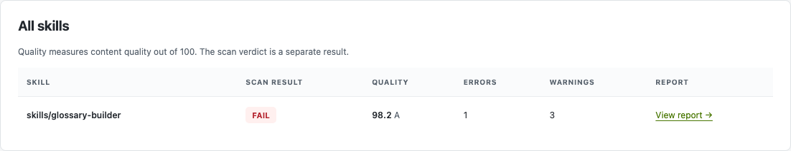

Bring skill evaluation to GitLab with a reusable CI job. Point it at your skills
and choose a quality threshold; merge requests evaluate changed skills
without installing scanners or adding evaluation code to your repository.
The shared container includes SkillSpector security scanning.

<Note>
  Use the generated configuration from an official CI image release. Until
  that release is available, the source template contains placeholders and is
  not runnable.
</Note>

## Get started

Open the [GitLab source template](https://github.com/NVIDIA/SkillEvaluator/blob/main/ci/templates/gitlab-skill-checks.yml)
in the public NVIDIA/SkillEvaluator repository. It is maintained alongside the
GitHub templates; you do not need a GitLab mirror or a local onboarding CLI.
The [template catalog](https://github.com/NVIDIA/SkillEvaluator/blob/main/ci/templates/README.md)
explains how to get the release-generated version with the workflow and image
versions filled in.

<Steps>

### Add the reusable job

Download `gitlab-skill-checks.yml` from the release bundle. For a new pipeline,
use its contents as `.gitlab-ci.yml`. For an existing pipeline, merge its
`include`, variables and `skill-evaluation` rules into your root file.

### Choose your skills and score

Set `SKILL_EVAL_PATHS` to your skill directory and `SKILL_EVAL_MIN_SCORE` to the
required quality score from 0 to 100 (default 70). For multiple roots, use a
YAML multiline string.

### Open a merge request

The job evaluates changed skills, shows the result in the pipeline, and retains
reports as job artifacts, including when a check fails.

</Steps>

The generated file has this shape; the release fills in the immutable pins:

```yaml title=".gitlab-ci.yml"
include:
  - remote: https://raw.githubusercontent.com/NVIDIA/SkillEvaluator/RELEASE_WORKFLOW_SHA/ci/gitlab/skill-evaluation.yml
variables:
  SKILL_EVAL_IMAGE: ghcr.io/nvidia/skillevaluator-tier1@sha256:RELEASE_IMAGE_DIGEST
  SKILL_EVAL_PATHS: "skills"
  SKILL_EVAL_MIN_SCORE: "70"
skill-evaluation:
  rules:
    - if: '$CI_PIPELINE_SOURCE == "merge_request_event"'
    - if: '$CI_COMMIT_BRANCH == $CI_DEFAULT_BRANCH'
    - if: '$CI_PIPELINE_SOURCE == "web"'
```

A compatible runner must be able to pull the image and run Linux containers.
If it requires tags, add them to `skill-evaluation`. Static scanning needs no
model key, but dependency vulnerability checks may contact external services.

## See the results

Open the `skill-evaluation` job and download its `skill-evaluator-report`
artifact. Open `index.html` for the consolidated view, then select a skill for
its detailed HTML report. JSON, Markdown and SARIF are included.

<Frame caption="Real demo result: the skill scored 98.2 and failed a 100-point threshold. The score and the scan verdict are separate.">
  
</Frame>

The [public examples](https://github.com/NVIDIA/SkillEvaluator/blob/main/ci/examples/README.md)
include this report preview and a log excerpt without requiring access to a
separate demo project.

<Tabs>
  <Tab title="Job log">

    The log identifies the skill, result and quality score. This shortened
    excerpt is from the real demo run shown above:

```text
Skill result: "skills/glossary-builder" — FAILED
  Quality: 98.2/100, grade "A"
  Check: "QUALITY" — "failed"
    Scanner error: "Quality score 98.2/100 is below the required 100/100 ..."
```

  </Tab>
  <Tab title="Report artifact">

    Download the artifact from the job to inspect the overview and per-skill
    findings. Artifacts expire according to the job's retention settings.

  </Tab>
</Tabs>

<AccordionGroup>
  <Accordion title="When does it run?">
    `SKILL_EVAL_SCAN_MODE: auto` evaluates changed skills in detached
    merge-request pipelines and all configured skills on the default branch or
    a manual pipeline. Set it to `all` for a full scan each time. Changed-only
    selection needs the merge-request diff base and full Git history; missing
    history is an error, not a pass. Merged-results and merge-train pipelines
    must use `all` until changed-only selection is supported for them. Shared
    files outside skill directories do not select dependent skills; use `all`
    when those changes require a complete scan.
  </Accordion>
  <Accordion title="Fit the job into an existing pipeline">
    GitLab requires merge-request `rules` in the root `.gitlab-ci.yml`, even
    when a job is included. The generated file provides them. If your project
    has `workflow: rules`, ensure they allow merge-request pipelines while
    preserving your existing policy. The job uses the `test` stage by default;
    override its stage if your pipeline does not define it. A failed or
    incomplete job fails the pipeline; configure your GitLab merge policy if it
    should also block merging.
  </Accordion>
  <Accordion title="Scores, reports and privacy">
    The threshold applies to the quality score; security, schema and other
    required checks remain independent gates. The first version runs Tier 1
    only. This integration does not host reports or post merge-request comments
    automatically. Known values detected by credential patterns, NVIDIA API
    keys, and unquoted `KEY=value` and `Bearer` credentials are redacted,
    including parts of them that a scanner cuts or escapes, but not every
    secret or transformation is detectable. Raw scanner logs are
    withheld when a credential is present. Remove and rotate exposed
    credentials; previous artifacts and Git history are not rewritten.
  </Accordion>
</AccordionGroup>

For GitHub and other CI systems, see [Repository Integration](repository-integration.mdx).
