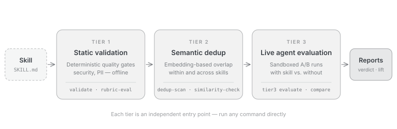

SkillEvaluator is an open-source, multi-tier framework for evaluating AI agent artifacts, starting with agent skills: deterministic quality gates, semantic overlap detection, synthetic eval dataset generation, and live agent evaluation.

Agent skills are folders of instructions and supporting files that extend AI agents, as defined by the [Agent Skills specification](https://agentskills.io/). SkillEvaluator is part of the [NVIDIA Verified Skills pipeline](https://docs.nvidia.com/skills/), published from the [NVIDIA/skills catalog](https://github.com/NVIDIA/skills). Tier 1 integrates [SkillSpector](https://github.com/NVIDIA/SkillSpector) for specialized security scanning; see [Installation](installation.mdx#system-tools) for the security setup.

<Note>
  SkillEvaluator's support level is **Experimental**: community-supported on a best-effort basis through [GitHub Issues](https://github.com/NVIDIA/SkillEvaluator/issues), with no SLA. See [SUPPORT.md](https://github.com/NVIDIA/SkillEvaluator/blob/main/SUPPORT.md).
</Note>

<a id="try-it-in-two-minutes" />

## Start with a first result

Choose a deterministic quality check or an LLM-backed rubric review. Both routes
use the bundled `text-analyzer` skill, so you can run them before preparing your
own skill. Neither route needs Docker or an agent runtime. Set up your chosen
agent and sandbox when you move on to [live Tier 3 evaluation](tier3-live-evaluation.mdx).

### Run without an LLM

Install [uv](https://docs.astral.sh/uv/getting-started/installation/) and Git,
then clone the repository and run the base package:

```bash title="Quality check with no API key"
git clone --depth 1 https://github.com/NVIDIA/SkillEvaluator.git
cd SkillEvaluator
uv run --python 3.13 skillevaluator quality-check src/skillevaluator/tier3/reference_skills/text-analyzer -r cli -r json -o reports/first-quality
```

Read the score, grade, and findings in the terminal, and open
`reports/first-quality/skillevaluator-quality.json` for the saved result.
This checks documentation quality; measuring the skill's effect on an agent
requires a [live evaluation](tier3-live-evaluation.mdx).

The [keyless Quickstart](quickstart.mdx#run-without-an-llm) explains the result
and how to check your own skill. The full static security suite has additional
[scanner requirements](installation.mdx#system-tools), even though it also
runs without an LLM or API key.

### Use NVIDIA Build

For an LLM-backed rubric review, get an API key from
[NVIDIA Build](https://build.nvidia.com/), then run from the same checkout:

```bash title="LLM-backed rubric review"
export SKILL_EVAL_LLM_PROVIDER=nv_build
export NVIDIA_API_KEY='nvapi-...'
uv run --python 3.13 --extra llm skillevaluator rubric-eval src/skillevaluator/tier3/reference_skills/text-analyzer -r cli -r json -o reports/first-build
```

The `llm` extra installs the provider clients for this model call. The
[NVIDIA Build Quickstart](quickstart.mdx#use-nvidia-build) covers access,
outputs, and the distinction between rubric scores and observed agent behavior.

## The three tiers

Each tier answers one question about your skill.

<CardGroup cols={3}>
  <Card title="Tier 1: Validation" href="tier1-validation.mdx">
    **Is this skill safe and well-formed?** Deterministic schema, quality, security, PII, license, and script checks that run offline — plus optional LLM-as-judge scoring.
  </Card>
  <Card title="Tier 2: Deduplication" href="tier2-deduplication.mdx">
    **Does it overlap with what exists?** Embedding similarity finds repeated guidance inside one skill and overlapping skills across a collection or catalog.
  </Card>
  <Card title="Tier 3: Live Evaluation" href="tier3-live-evaluation.mdx">
    **Does it actually help the agent?** A real agent runs generated tasks with and without the skill, inside a sandbox, and the difference is measured.
  </Card>
</CardGroup>

Every tier is an independent entry point — run any command directly; nothing requires running the earlier tiers first.

| Tier | Representative commands | Requires |
| --- | --- | --- |
| [Tier 1](tier1-validation.mdx) | `tier1 PATH`, `quality-check`, `security-scan`, `pii-scan`, `lint-scripts`, `rubric-eval` | No API key for deterministic checks; the `security` extra plus external Semgrep, SkillSpector, and Gitleaks executables for full scanner coverage; a provider key for LLM checks |
| [Tier 2](tier2-deduplication.mdx) | `context-optimization-check`, `similarity-check` | An embeddings provider; intra-skill analysis also needs a chat LLM — local OpenAI-compatible endpoints work |
| [Tier 3](tier3-live-evaluation.mdx) | `create-eval-dataset`, `tier3 evaluate`, `compare` | No credential for keyless templates and report inspection; a provider key for LLM generation and grading; live evaluation also needs the agent CLI with its credential and a Docker, local OS, or cloud sandbox |

## How a run flows

<Frame background="subtle" caption="The SkillEvaluator three-tier pipeline">
  
</Frame>

`skillevaluator validate ./my-skill` runs all three tiers by default, with
Tier 3 autopilot reusing an existing evaluation source or creating one starter
case when none exists. Tier 1's deterministic gates run offline. Tier 2 and the optional Tier 1 LLM checks need a provider key, and Tier 3 adds the agent credential and a sandbox. Every run ends in [reports](reports.mdx) — CLI, JSON, HTML, or Markdown.

## What Tier 3 measures

- **Five dimensions** — Security, Correctness, Discoverability, Effectiveness, and Efficiency: human-readable scores that lead every standard grading report.
- **Skill Lift** — the measured difference between the with-skill and without-skill runs; the number that says whether the skill earns its place.
- **pass@k** — multi-attempt reliability, reported separately from the dimension scores.

How to read all three, and the on-disk results contract, live in [Reports & Results](reports.mdx).

## Explore the docs

<CardGroup cols={2}>
  <Card title="Quickstart" icon="rocket" href="quickstart.mdx">
    Run a bundled quality check without an LLM, or use NVIDIA Build for a rubric review.
  </Card>
  <Card title="Gate Your CI" icon="shield" href="ci-integration.mdx">
    Make SkillEvaluator a merge gate — exit codes, a GitHub Actions recipe, and progressive adoption.
  </Card>
  <Card title="CLI Reference" icon="terminal" href="cli-reference.mdx">
    Every command, every flag, exact defaults.
  </Card>
  <Card title="Contributing" icon="book" href="developer-guide.mdx">
    Dev environment, tests, docs workflow, and how to submit a change.
  </Card>
</CardGroup>

- [SkillEvaluator on GitHub](https://github.com/NVIDIA/SkillEvaluator)
- [Support](https://github.com/NVIDIA/SkillEvaluator/blob/main/SUPPORT.md) — best-effort, through GitHub Issues
- [Security policy](https://github.com/NVIDIA/SkillEvaluator/blob/main/SECURITY.md) — report vulnerabilities privately, never in a public issue
- [License](https://github.com/NVIDIA/SkillEvaluator/blob/main/LICENSE) — Apache-2.0
