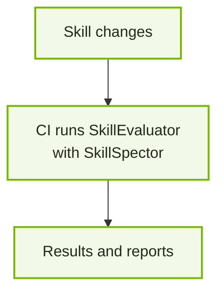
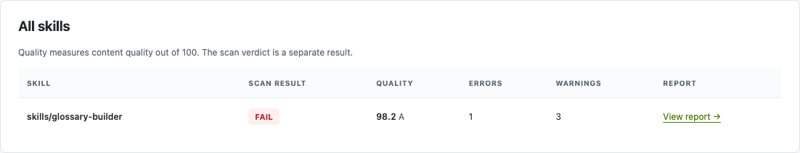

Bring quality and security checks to your repository. No model key required.
Optional LLM checks are available. Choose your skill folders and get results
automatically when skills change.

No evaluation code to write. No scanner installations to manage. The shared
container runs the checks in your CI runner, including SkillSpector security
scanning.

## How it works



The job reads your skills, checks the changes, and saves a report. It does not
require copying SkillEvaluator or SkillSpector source code into your repository.

<CardGroup cols={2}>
  <Card title="GitHub Actions" icon="file-code" href="/skills/skillevaluator/github-actions">
    Use the guided CLI or copy a workflow to check skills in pull requests, with optional hosted reports and comments.
  </Card>
  <Card title="GitLab CI/CD" icon="code-branch" href="/skills/skillevaluator/gitlab-ci">
    Include the reusable job in your pipeline to evaluate changed skills in merge requests and download the report.
  </Card>
</CardGroup>

## Copy a template

No local installation is required for the template route. Both platforms' templates
live in the public NVIDIA/SkillEvaluator repository. Open the file, copy the
filled-in version, and set your skill folders and score threshold.

| Your platform | Ready-to-use template | Put it in your repository |
| --- | --- | --- |
| GitHub | [skill-checks.yml](https://github.com/NVIDIA/SkillEvaluator/blob/main/ci/bundles/1.0.1/skill-checks.yml) | `.github/workflows/skill-checks.yml` |
| GitHub PR comments without hosting | [comment-skill-checks.yml](https://github.com/NVIDIA/SkillEvaluator/blob/main/ci/bundles/1.0.1/comment-skill-checks.yml) | `.github/workflows/comment-skill-checks.yml`, alongside the scan |
| GitLab | [gitlab-skill-checks.yml](https://github.com/NVIDIA/SkillEvaluator/blob/main/ci/bundles/1.0.1/gitlab-skill-checks.yml) | `.gitlab-ci.yml`, or merge into your existing root configuration |

The [ready-to-use templates](https://github.com/NVIDIA/SkillEvaluator/tree/main/ci/bundles/1.0.1)
include the scan configurations, comments without hosting and optional GitHub
publisher, with reviewed workflow
and image versions already filled in. Open a file and use GitHub's **Raw** view
to copy its full contents. The [template catalog](https://github.com/NVIDIA/SkillEvaluator/blob/main/ci/templates/README.md)
explains customization and optional LLM checks.

## What you get

- **Automatic checks:** evaluate changed skills in pull requests or merge requests; run the configured collection on the default branch.
- **Quality and security:** check your skills with SkillEvaluator and SkillSpector without adding evaluator code to the repository.
- **Control:** choose skill directories and a minimum quality score; the job fails when required checks fail or cannot complete.
- **Results you can inspect:** see a concise outcome in CI and download the detailed HTML, JSON, Markdown and SARIF reports.

<Frame caption="A real demo result: one changed skill scored 98.2 but failed a 100-point quality threshold.">
  
</Frame>

Browse [report, log and PR comment examples](https://github.com/NVIDIA/SkillEvaluator/blob/main/ci/examples/README.md)
in the public repository. No demo-repository access is needed.

<Note>
  These quality and security checks are called **Tier 1** in SkillEvaluator
  reports. GitHub and GitLab use the same scanner image with platform-specific
  workflow files. Additional evaluation stages require a separate opt-in.
</Note>

## Pre-commit hooks

Run the deterministic, key-free Tier 1 checks on the skills a commit touches,
without waiting for CI. The hooks install SkillEvaluator from this repository
and call a hidden `skillevaluator precommit-run` entry that maps each changed
file to its skill root (the nearest ancestor that contains `SKILL.md`, or a
lowercase `skill.md` that the schema check then flags; names match exactly on
every OS),
de-duplicates those roots, and runs one check per skill. The hooks set
`require_serial: true` so pre-commit passes all files to one process and a
skill is not checked once per parallel chunk.

Files that are not inside a skill are ignored. Deleted skills are skipped.
Reports are not written into the repository.

### Install

Add a `.pre-commit-config.yaml` at the root of the skill repository and pin
`rev` to a released tag that includes
[`.pre-commit-hooks.yaml`](https://github.com/NVIDIA/SkillEvaluator/blob/main/.pre-commit-hooks.yaml).
Replace `<release tag>` in the example with that tag; `v0.9.0` and earlier
releases do not include the hooks.

The hooks use `language: python`, so pre-commit builds their environment with
the Python it runs under unless told otherwise. SkillEvaluator needs Python
3.12, 3.13, or 3.14; under an older or newer interpreter the first commit fails
while installing the hook with a pip `Requires-Python` error. That includes
macOS `/usr/bin/python3` (3.9), Ubuntu 22.04 (3.10), and Debian 12 (3.11).
Set `default_language_version` to a supported interpreter on your `PATH`, as
the example does, or set `language_version` on each hook:

```yaml title=".pre-commit-config.yaml"
default_language_version:
  python: python3.13
repos:
  - repo: https://github.com/NVIDIA/SkillEvaluator
    rev: <release tag>
    hooks:
      - id: skillevaluator-quality
        args: ["--min-score", "70"]
      - id: skillevaluator-schema
      - id: skillevaluator-lint-scripts
```

Then `pre-commit install`. The first commit (or `pre-commit install
--install-hooks`) builds the hook environment, which needs network access to
fetch SkillEvaluator and its dependencies from the pinned repo and PyPI; later
runs reuse the cached environment. On each commit, pre-commit passes the changed
skill files (`SKILL.md`, `skill.md`, and anything under the skill directories the
schema check allows: `agents/`, `assets/`, `config/`, `evals/`, `references/`,
`scripts/`, `tests/`, `tools/`) to the selected hooks.

`--min-score` and `--quality-config` are forwarded to the quality check, the
same options `quality-check` takes. Omit `args` to keep the default quality bar
of 70 and the packaged `quality-default.yaml`. To score commits the same way CI
does, pass the same config file, with a path relative to the repository root:

```yaml
      - id: skillevaluator-quality
        args: ["--min-score", "80", "--quality-config", "quality.yaml"]
```

### What each hook checks

| Hook id | Check | Needs |
| --- | --- | --- |
| `skillevaluator-quality` | Composite quality score (`quality-check`) | Python 3.12-3.14 only |
| `skillevaluator-schema` | `SKILL.md` frontmatter and skill layout (`validate --tiers 1 --checks schema`; honours `SKILLEVALUATOR_PROFILE`) | Python 3.12-3.14 only |
| `skillevaluator-lint-scripts` | Advisory Python script lint (`lint-scripts`) | Python 3.12-3.14 only |

Each hook prints one compact line per skill (`PASS` or `FAIL`) and exits
non-zero when any skill fails. Script lint findings are advisory, so that hook
does not fail the commit on style warnings. It prints the finding count and the
first three findings for each skill, and sets `verbose: true` so pre-commit
shows that output even though the hook passes. Run `skillevaluator lint-scripts`
on the skill to see every finding.

### What the hooks do not run

Once the hook environment is installed, running the checks stays offline: no
API key, no network, no Docker, and no scanner download.

They do **not** run:

- Security scans (`security-scan`, Gitleaks, SkillSpector, Semgrep). The first
  full scan can download pinned scanner releases.
- `doctor` / `health-check`, which probe those scanners.
- Default `validate` (or `--tiers 1` without `--checks`). That lineup includes
  security and code-integrity scans.
- LLM-backed rubric scoring, Tier 2 deduplication, and Tier 3 live evaluation.

Other keyless static checks (PII, license, Unicode, version, harness) are also
omitted from the hook set. Run them with `validate --tiers 1` in CI once the
scanners the remaining checks need are installed. Use the
[GitHub](/skills/skillevaluator/github-actions) or
[GitLab](/skills/skillevaluator/gitlab-ci) templates for scanner-backed CI, and
[Gate Your CI](/skills/skillevaluator/ci-integration) for a copy-paste job.

## Other CI systems

The container contains the same evaluator runtime, and the CLI can also run in
other CI systems. The [CI integration guide](/skills/skillevaluator/ci-integration) covers the CLI,
exit codes and report formats. The GitHub and GitLab integrations above have
separate platform-specific configurations; another platform needs its own
integration and validation.
