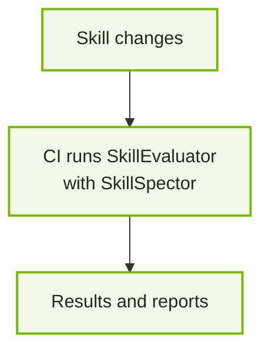
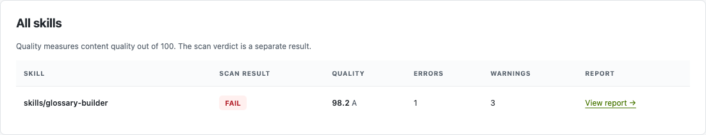

Bring quality and security checks to your repository. No model key required.
Optional LLM checks are available. Choose your skill folders and get results
automatically when skills change.

No evaluation code to write. No scanner installations to manage. The shared
container runs the checks in your CI runner, including SkillSpector security
scanning.

## How it works

The job reads your skills, checks the changes, and saves a report. It does not
require copying SkillEvaluator or SkillSpector source code into your repository.

<CardGroup cols={2}>
  <Card title="GitHub Actions" icon="file-code" href="/skills/skillevaluator/github-actions">
    Use the guided CLI or copy a workflow to check skills in pull requests, with optional hosted reports and comments.
  </Card>
  <Card title="GitLab CI/CD" icon="code-branch" href="/skills/skillevaluator/gitlab-ci">
    Include the reusable job in your pipeline to evaluate changed skills in merge requests and download the report.
  </Card>
</CardGroup>

## Copy a template

No local installation is required for the template route. Both platforms' templates
live in the public NVIDIA/SkillEvaluator repository. Open the file, copy the
filled-in version, and set your skill folders and score threshold.

| Your platform | Ready-to-use template | Put it in your repository |
| --- | --- | --- |
| GitHub | [skill-checks.yml](https://github.com/NVIDIA/SkillEvaluator/blob/main/ci/bundles/0.9.0/skill-checks.yml) | `.github/workflows/skill-checks.yml` |
| GitLab | [gitlab-skill-checks.yml](https://github.com/NVIDIA/SkillEvaluator/blob/main/ci/bundles/0.9.0/gitlab-skill-checks.yml) | `.gitlab-ci.yml`, or merge into your existing root configuration |

The [ready-to-use templates](https://github.com/NVIDIA/SkillEvaluator/tree/main/ci/bundles/0.9.0)
include the scan workflows and optional GitHub publisher, with reviewed workflow
and image versions already filled in. Open a file and use GitHub's **Raw** view
to copy its full contents. The [template catalog](https://github.com/NVIDIA/SkillEvaluator/blob/main/ci/templates/README.md)
explains customization and optional LLM checks.

## What you get

- **Automatic checks:** evaluate changed skills in pull requests or merge requests; run the configured collection on the default branch.
- **Quality and security:** check your skills with SkillEvaluator and SkillSpector without adding evaluator code to the repository.
- **Control:** choose skill directories and a minimum quality score; the job fails when required checks fail or cannot complete.
- **Results you can inspect:** see a concise outcome in CI and download the detailed HTML, JSON, Markdown and SARIF reports.

<Frame caption="A real demo result: one changed skill scored 98.2 but failed a 100-point quality threshold.">
  
</Frame>

Browse [report, log and PR comment examples](https://github.com/NVIDIA/SkillEvaluator/blob/main/ci/examples/README.md)
in the public repository. No demo-repository access is needed.

<Note>
  These quality and security checks are called **Tier 1** in SkillEvaluator
  reports. GitHub and GitLab use the same scanner image with platform-specific
  workflow files. Additional evaluation stages require a separate opt-in.
</Note>

## Other CI systems

The container contains the same evaluator runtime, and the CLI can also run in
other CI systems. The [CI integration guide](/skills/skillevaluator/ci-integration) covers the CLI,
exit codes and report formats. The GitHub and GitLab integrations above have
separate platform-specific configurations; another platform needs its own
integration and validation.
