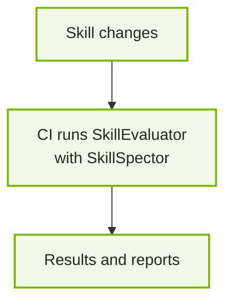

Bring SkillEvaluator to the repository where your team builds skills. Choose
your skill folders and get results automatically when skills change.

No evaluation code to write. No scanner installations to manage. The shared
container brings the Tier 1 runtime to your CI runner, including SkillSpector
for specialized skill security scanning.

## How it works

The job reads your skills, checks the changes, and saves a report. It does not
require copying SkillEvaluator or SkillSpector source code into your repository.

<CardGroup cols={3}>
  <Card title="CLI setup · Preview" icon="terminal" href="/skills/skillevaluator/cli-onboarding">
    Answer a few questions and review a generated GitHub setup PR, with optional hosted reports and comments.
  </Card>
  <Card title="GitHub Actions" icon="file-code" href="/skills/skillevaluator/github-actions">
    Copy the released workflow and choose your skill folders. No local CLI installation required.
  </Card>
  <Card title="GitLab CI/CD" icon="code-branch" href="/skills/skillevaluator/gitlab-ci">
    Include the reusable job in your pipeline to evaluate changed skills in merge requests and download the report.
  </Card>
</CardGroup>

## Copy a template

No local installation is required for the template route. Both platforms' templates
live in the public NVIDIA/SkillEvaluator repository. Open the file, copy the
release-generated version, and set your skill folders and score threshold.

| Your platform | Ready-to-use template | Put it in your repository |
| --- | --- | --- |
| GitHub | [skill-checks.yml](https://github.com/NVIDIA/SkillEvaluator/releases/download/ci-0.7.0/skill-checks.yml) | `.github/workflows/skill-checks.yml` |
| GitLab | [gitlab-skill-checks.yml](https://github.com/NVIDIA/SkillEvaluator/releases/download/ci-0.7.0/gitlab-skill-checks.yml) | `.gitlab-ci.yml`, or merge into your existing root configuration |

Download the filled-in GitHub or GitLab scan template from the
[CI 0.7.0 release](https://github.com/NVIDIA/SkillEvaluator/releases/tag/ci-0.7.0).
The [template catalog](https://github.com/NVIDIA/SkillEvaluator/blob/main/ci/templates/README.md)
also contains source templates for optional GitHub publishing and LLM checks.
Those source files contain placeholders; the CI 0.7.0 bundle includes scan
templates, not the optional publisher.

## What you get

- **Automatic checks:** evaluate changed skills in pull requests or merge requests; run the configured collection on the default branch.
- **Quality and security:** run Tier 1 checks, including SkillSpector security scanning, without adding evaluator code to the repository.
- **Control:** choose skill directories and a minimum quality score; the job fails when required checks fail or cannot complete.
- **Results you can inspect:** see a concise outcome in CI and download the detailed HTML, JSON, Markdown and SARIF reports.

<Frame caption="A real demo result: one changed skill scored 98.2 but failed a 100-point quality threshold.">
  
</Frame>

Browse [report, log and PR comment examples](https://github.com/NVIDIA/SkillEvaluator/blob/main/ci/examples/README.md)
in the public repository. No demo-repository access is needed.

<Note>
  The released CI image runs Tier 1, including SkillSpector. It does not run
  Tier 2 or Tier 3. The guided CLI is a local preview; its page explains the
  current availability and test-repository requirements.
</Note>

## Other CI systems

The container contains the same evaluator runtime, and the CLI can also run in
other CI systems. The [CI integration guide](/skills/skillevaluator/ci-integration) covers the CLI,
exit codes and report formats. The GitHub and GitLab integrations above have
separate platform-specific configurations; another platform needs its own
integration and validation.
