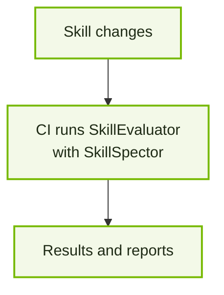

Bring SkillEvaluator to the repository where your team builds skills. Add a
reusable CI configuration, point it at your skill directories, and get
results automatically when skills change.

No evaluation code to write. No scanner installations to manage. The shared
container brings the Tier 1 runtime to your CI runner, including SkillSpector
for specialized skill security scanning.

## How it works

The job reads your skills, checks the changes, and saves a report. It does not
require copying SkillEvaluator or SkillSpector source code into your repository.

<CardGroup cols={2}>
  <Card title="GitHub Actions" href="github-actions.mdx">
    Add one workflow file to evaluate changed skills in pull requests and open the results in GitHub Actions.
  </Card>
  <Card title="GitLab CI/CD" href="gitlab-ci.mdx">
    Include the reusable job in your pipeline to evaluate changed skills in merge requests and download the report.
  </Card>
</CardGroup>

## What you get

- **Automatic checks:** evaluate changed skills in pull requests or merge requests; run the configured collection on the default branch.
- **Quality and security:** run Tier 1 checks, including SkillSpector security scanning, without adding evaluator code to the repository.
- **Control:** choose skill directories and a minimum quality score; the job fails when required checks fail or cannot complete.
- **Results you can inspect:** see a concise outcome in CI and download the detailed HTML, JSON, Markdown and SARIF reports.

<Frame caption="A real demo result: one changed skill scored 98.2 but failed a 100-point quality threshold.">
  
</Frame>

<Note>
  The first release covers Tier 1. It does not run Tier 2 or Tier 3. An official
  CI image release is required before the release-generated configurations can
  be used. The source templates contain placeholders until then.
</Note>

## Other CI systems

The container contains the same evaluator runtime, and the CLI can also run in
other CI systems. The [CI integration guide](ci-integration.mdx) covers the CLI,
exit codes and report formats. The GitHub and GitLab integrations above have
separate platform-specific configurations; another platform needs its own
integration and validation.
